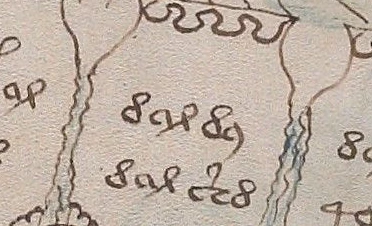

# One label, two readings

Look at the upper line of writing between the outlined figures. This is location 22 on the back of leaf 75, usually cited as **f75v.22**. Where would you put a word space?

The position of this label in the photograph is approximate. Inspect the detail at its original resolution or open the entire page to see what surrounds it. Courtesy of the Yale University Library, Beinecke Rare Book and Manuscript Library, MS 408. [Original Yale detail](https://collections.library.yale.edu/iiif/2/1006209/902,1309,372,226/full/0/default.jpg) · [Full folio photograph](https://collections.library.yale.edu/iiif/2/1006209/full/full/0/default.jpg)

| Transcription | What it records | Words counted |
|---|---|---:|
| René Zandbergen and Gabriel Landini, ZL3b | `daldy` | 1 |
| Takeshi Takahashi, IT2a | `dal.dy` | 2 |

The Latin letters are EVA, a convention for representing manuscript signs. The dot in Takahashi’s edition records a word space after the third character. Remove that dot and both editions give exactly the same five characters. You can check the source files by searching each for `<f75v.22,`. [ZL3b text](https://www.voynich.nu/data/ZL3b-n.txt) · [IT2a text](https://www.voynich.nu/data/IT2a-n.txt) · [Guide to the transcriptions](https://www.voynich.nu/transcr.html)

This small editorial choice recurs across the book. Of 5,214 locations present in both editions, **707** agree on the primary sequence of characters and differ in their word boundaries. A researcher looking for repeated words can therefore get different counts from the same photographed ink.

## Can a spelling pattern put a page back together?

In a separate experiment we took 12-word fragments from the upper and lower portions of pairs of pages and hid the page names. Each pair shared a gathering, illustration class, recorded hand and Currier class. A scorer that compared three-character sequences correctly paired **41 of 61** puzzles. Random pairing would succeed half the time.

One of its **20 mistakes** involved this very leaf. In puzzle J002 the candidates were f75v and f77v. Whole-word spellings selected the correct pairing, while the three-character scorer swapped the endings. At f75v.22 we can verify which spaces an editor recorded. Reuniting anonymous passages remains a probabilistic judgment, even when a spelling cue works across many pages. [Photograph of f75v](https://collections.library.yale.edu/iiif/2/1006209/full/full/0/default.jpg)

**Citation.** Simone Systems Research, *Voynich Reconstruction Atlas*, edition 1.0.0 (25 November 2026), locus f75v.22, Yale image 1006209, and reassembly puzzle J002. Transcription data are distributed under CC0 by Voynich.nu. The image above is a cropped WebP derivative of the Yale photograph. [Transcription reuse terms](https://www.voynich.nu/roadmap.html#cop) · [Yale image reproduction policy](https://web.library.yale.edu/about/copyright/permission.html)
