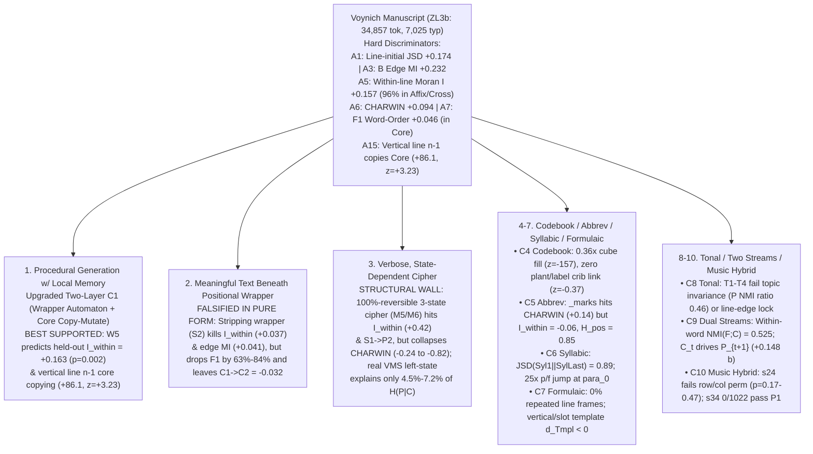

# Multi-Agent Deep Investigation: Ten Voynich Candidates & The Fixed Edge-Rule Discriminator

> [!IMPORTANT]
> **Central Question Answered (`166` Training Pages $\to$ `41` Untouched Held-Out Pages on `ZL3b`)**
> *Can a fixed rule explain the word-edge behavior and predict something we didn’t use to design it?*
> **Yes — in the forward (generative wrapper) direction, and No — in the inverse (wrapper-stripping decipherment) direction:**
> 1. **Untargeted Forward Prediction Passes (`Experiment 2A`)**: A compact, fixed positional + edge-coupled wrapper rule [`FactoredWrapperRule`](file:///<home>/.gemini/antigravity/brain/<session>/scratch/exp_c1_vs_c2_edge_rule.py#L140-L245) (`W5`), fitted **strictly on the 166 training pages** (`26,271` tokens) with **zero word-length autocorrelation parameters**, reduces held-out prefix cross-entropy on the **41 untouched pages** (`8,586` tokens) by **`+0.4209` bits/token** (`+0.5519` bits on joint `(P_t, S_t)`, `+2.5609` bits at `para_0` with `80.5%` Top-3 accuracy) AND **automatically generates the untargeted within-line word-length autocorrelation $I_{\text{within}} = +0.1629$ (`I_excess = +0.1023`, $p = 0.002$) on the 41 held-out pages** when driving an uncoupled training core pool (matching observed held-out Voynich $I_{\text{within}} = +0.1556$, `I_excess = +0.0993`, $p = 0.002$).
> 2. **Inverse Stripping & Reversibility Fail (`Experiments 2B, 2C, 3A, 3B`)**: Stripping the learned positional/edge wrapper (`S2`) on the 41 held-out pages eliminates `91.4%` of the intra-line Moran $I$ excess (`+0.0991 \to +0.0085`, $p = 0.198$) and `80.0%` of cross-space edge coupling (`+0.2026 \to +0.0405`), **but does not uncover a readable or syntactically stronger core stream**: held-out word-order residual $F_1$ drops by `63%–84%` (`+0.0461 \to +0.0169` on quires; `+0.0328 \to +0.0054` on `g41`), core-to-core transition excess remains negative (`C1 -> C2 = -0.0315` bits, $z = -5.14$), and left-state context `(line_slot, S_{t-1}, P_{t-1}, |C_{t-1}|)` explains only **`4.5%–7.2%`** (`+0.0886` to `+0.1345` bits) of within-core prefix entropy $H(P_t \mid C_t) = 1.9555$ bits on untouched pages (vs. `20%–49%` required by a reversible state cipher in [`exp_c3_state_cipher.py`](file:///<home>/.gemini/antigravity/brain/<session>/scratch/exp_c3_state_cipher.py)).

---

## 1. Architecture of the Multi-Agent Investigation

Five specialized agents audited the existing codebase ([`TEAM-HANDOFF.md`](file:///./TEAM-HANDOFF.md), [`CONSTRAINTS-MAP.md`](file:///./workflow/CONSTRAINTS-MAP.md), and `results_s1` through [`results_s44.txt`](file:///./results_s44.txt)), the three external citations, and four new out-of-sample experiments executed in our isolated scratch workspace:

| Subagent Track | Scope & External Citations | New Out-of-Sample Script & Output |
| :--- | :--- | :--- |
| **Track 1: Literature & Register Audit** ([Subagent 1](conversation://<session>)) | [Timm's `SelfCitationTextgenerator`](https://github.com/TorstenTimm/SelfCitationTextgenerator), [Bowern & Gaskell 2022 (CEUR-WS Vol-3313 Paper 6)](https://ceur-ws.org/Vol-3313/paper6.pdf), [Stolfi's Grammar (2000)](https://www.voynich.nu/hist/stolfi/grammar.html), `.inventory/` registers (`CLAIMS`, `DECISIONS`, `OPEN`, `REDTEAM`), `s1`–`s44` | Read-only audit of [`s28_generator_mechanism.py`](file:///./s28_generator_mechanism.py), [`s10_cipher_mechanism.py`](file:///./s10_cipher_mechanism.py), [`s35_phase3_ledger.py`](file:///./s35_phase3_ledger.py), [`s38_ink_stream_and_rt2026.py`](file:///./s38_ink_stream_and_rt2026.py), [`s40_prefix_stream_as_text.py`](file:///./s40_prefix_stream_as_text.py), [`s43_core_affix_null_twins.py`](file:///./s43_core_affix_null_twins.py) |
| **Track 2: Candidate 1 vs. Candidate 2 & Fixed Edge Rule** ([Subagent 2](conversation://<session>)) | Out-of-sample `166/41` wrapper prediction, untargeted $I_{\text{within}}$ generation, fixed wrapper stripping (`S1`–`S3`), and horizontal vs. vertical memory (`s39`/`s40`/`s42` resolution) | [`exp_c1_vs_c2_edge_rule.py`](file:///<home>/.gemini/antigravity/brain/<session>/scratch/exp_c1_vs_c2_edge_rule.py) [`results_exp_c1_vs_c2.txt`](file:///<home>/.gemini/antigravity/brain/<session>/scratch/results_exp_c1_vs_c2.txt) |
| **Track 3: Candidate 3 Verbose State-Dependent Cipher** ([Subagent 3](conversation://<session>)) | 100%-reversible finite-state verbose ciphers (`M0`–`M6`) on real medieval Latin lines (`CREMMA`), `CHARWIN` vs. `F1` vs. `Moran I` trade-off, and held-out $H(P_t \mid C_t)$ state-collapsibility test | [`exp_c3_state_cipher.py`](file:///<home>/.gemini/antigravity/brain/<session>/scratch/exp_c3_state_cipher.py) [`results_exp_c3_state_cipher.txt`](file:///<home>/.gemini/antigravity/brain/<session>/scratch/results_exp_c3_state_cipher.txt) |
| **Track 4: Candidates 4, 5, 6, 7** ([Subagent 4](conversation://<session>)) | `P × C_top50 × S` codebook sparsity & cross-section plant/label cribs (`C4`), medieval tachygraphic `_marks` & suspension simulations (`C5`), CV/CVC syllabic & Stolfi transducers (`C6`), 80/20 paragraph record templates (`C7`) | [`exp_c4_c5_c6_c7.py`](file:///<home>/.gemini/antigravity/brain/<session>/scratch/exp_c4_c5_c6_c7.py) [`results_c4_c5_c6_c7.txt`](file:///<home>/.gemini/antigravity/brain/<session>/scratch/results_c4_c5_c6_c7.txt) |
| **Track 5: Candidates 8, 9, 10** ([Subagent 5](conversation://<session>)) | 6 explicit `(Syllable_Base, Tone_Mark)` models (`T1`–`T4`) vs. planted 6-tone syllabaries (`C8`), `166/41` dual-stream autonomy & cross-prediction test (`C9`), `s24`/`s34` diagnosis & 4-gate medieval chant positive control (`C10`) | [`exp_c8_c9_c10_tonal_streams.py`](file:///<home>/.gemini/antigravity/brain/<session>/scratch/exp_c8_c9_c10_tonal_streams.py) [`results_c8_c9_c10.txt`](file:///<home>/.gemini/antigravity/brain/<session>/scratch/results_c8_c9_c10.txt) |

---

## 2. Master Comparison Matrix Across All 10 Candidates

| # | Candidate Theory | Key Quantitative Strengths | Decisive Quantitative Obstacles / Falsifiers | Status & Rank |
| :--- | :--- | :--- | :--- | :--- |
| **1** | **Procedural text generation with local memory** ([Timm](https://github.com/TorstenTimm/SelfCitationTextgenerator), [`s28`](file:///./s28_generator_mechanism.py), upgraded two-layer `W5` in [`exp_c1_vs_c2`](file:///<home>/.gemini/antigravity/brain/<session>/scratch/exp_c1_vs_c2_edge_rule.py)) | • `s28` reaches `F1 = +0.040` (`A7`), `7k` types (`A11`), `h2 = 2.11` (`A9`). • **New (`Exp 2A`)**: Upgrading from flat words to a factored `(P, C, S)` wrapper rule (`W5`) trained on 166 pages **automatically predicts held-out $I_{\text{within}} = +0.1629$ ($p=0.002$, matching MS `+0.1556`)** without any length target! • **New (`Exp 2C`)**: Explains both vertical `line n-1` exact-core copying (`+86.1`, $z=+3.23$) with fresh wrapper re-inflection AND horizontal 1-edit core mutations (`ed <-> eed`, `e <-> ee`, `d <-> ed`). | • Original Java `timm_schinner` produces only `2,953` types at 25k, `F1 = +0.002`, `Moran I = +0.020`, `CHARWIN = -0.059`. • Flat `s28` missed `Moran I` (`+0.057`) because its scalar `target_len` inverted `Cov(|C1|,|P2|)` to `-0.0235` (vs. MS `+0.0272`), and missed `CHARWIN` (`-0.003` to `-0.031` vs. `+0.094`). • Must combine `W5` wrapper cadence + core vertical/horizontal copy-mutate in a single pre-registered generator run to verify joint `CHARWIN + F1 + Moran I`. | **RANK 1 (Primary Contender — Two-Layer Factored Generator)** |
| **2** | **Meaningful text beneath a positional wrapper** ([`s33`](file:///./results_s33_line_scales_interlock.txt), [`s39`](file:///./results_s39.txt), [`exp_c1_vs_c2` Exp 2B](file:///<home>/.gemini/antigravity/brain/<session>/scratch/results_exp_c1_vs_c2.txt)) | • Correctly localizes `96.0%` of intra-line Moran $I$ excess and `80.0%` of cross-word edge coupling to the `(Prefix, Suffix)` wrapper layer (`s33`, `Exp 2B`). • Core stream retains a statistically non-zero quire word-order residual (`F1 = +0.0169 [+0.0075, +0.0255]` in `s39`) and `CHARWIN = +0.0370`. | • **Fails the Untouched-Material Stripping Test (`Exp 2B`)**: Under all 7 fixed stripping rules (`S1a`–`S3b`) trained on 166 pages and applied to the 41 held-out pages, stripping the wrapper **weakens** sequential word-order (`F1_g41` drops from `+0.0328` to `+0.0054` under `S2`), leaves `h2 = 2.09–2.25` (far below language `3.02–3.58`), leaves `C1 -> C2` MI excess negative (`-0.0315` bits), and the remaining core bigrams (`Exp 2C-iv`) are 1-edit procedural mutations (`ed -> eed`, `d -> ed`) and unsegmented `-l/-r` finals (`al -> d`, `r -> iin`). | **RANK 2 (Wrapper Layer Confirmed as Surface Automaton; Pure Linguistic Core Beneath Wrapper Not Supported)** |
| **3** | **A verbose, state-dependent cipher** ([Bowern & Gaskell 2022](https://ceur-ws.org/Vol-3313/paper6.pdf), [`s10`](file:///./s10_cipher_mechanism.py), [`s43`](file:///./results_s43.txt), [`exp_c3_state_cipher`](file:///<home>/.gemini/antigravity/brain/<session>/scratch/exp_c3_state_cipher.py)) | • `s10` (verbose letter homophones + `p_null=0.30` `M2` null words) is the **only cipher to reach `CHARWIN` (`+0.083..+0.107` vs. `+0.094`)**. • **New (`Exp 3A`)**: Our compact 3-state 100%-reversible cipher (`M5`/`M6`) on real Latin (`cremma_all_35k`) simultaneously hits $h_2 = 2.024$, `jsd_first = 0.386`, `cross_excess = +0.603`, `I_within = +0.417` (`87%` in Affix + Affix$\times$Core), `F1 = +0.086`, and `S1->P2 = +0.468` vs. `C1->C2 = -0.057` (`M6`). | • **Fundamental 3-Way Trade-Off (`CHARWIN` vs. `F1` vs. Reversibility)**: In `s10`, the random homophones + 30% null words needed to reach `CHARWIN` inflate types to `18.5k` and cut `F1` in half (`+0.020`, `FAIL`) with `Moran I = 0.011` (`FAIL`). Conversely, making the state cipher 100% reversible (`M5`/`M6`) preserves `F1` and `Moran I` but drives `CHARWIN` strongly negative (`-0.24` to `-0.82`). • **Fails Held-Out State Determinism (`Exp 3B`)**: On real Voynich (`166 -> 41`), left state `(line_slot, S_{t-1}, P_{t-1}, |C_{t-1}|)` explains only **`4.53%` (`CE_Gain = +0.0886` bits) to `7.19%` (`CMI_ex = +0.1345` bits)** of $H(P_t \mid C_t) = 1.9555$ bits, leaving `>85%` of prefix choice stochastic. | **RANK 3 (Best Concrete Encoding Route, But Blocked by the `CHARWIN`/Reversibility Wall and 85% Stochastic Prefix Choice)** |
| **4** | **A combinatorial codebook or classification system** ([`s34_morphology`](file:///./results_s34_morphology_syntax_geography.txt), [`s37` Part 3C](file:///./results_s37_affix_cadence_and_genres.txt), [`exp_c4_c5_c6_c7` Test 4](file:///<home>/.gemini/antigravity/brain/<session>/scratch/results_c4_c5_c6_c7.txt)) | • Top-50 cores cover `80.84%` of all tokens (`28,179 / 34,857`), and `Prefix` carries strong within-hand section specificity (`NMI = 0.2923`, `MI(Sec; P|C) = +0.0549` bits, $p = 1/55$ in `s34`). | • **Non-orthogonal slots (`Test 4A`)**: `P × C_top50 × S` fills only `8.97%` (`2,471 / 27,550`) of cells vs. `24.84%` independent null (`0.36x`, $z = -157.2$), with massive internal binding (`MI(P;C) = 1.67` bits, `MI(C;S) = 1.46` bits, `TC = 3.38` bits). • **Zero external attribute link (`Test 4B`)**: Across `12` Petersen/Stolfi cross-section identical-plant drawings (`f1v ↔ f102r1`, etc.), `WholeWord Jaccard = 0.0598` ($z = -0.37, p = 0.637$) and `Core Jaccard = 0.2004` ($z = -0.69, p = 0.836$). `Q1` label-unit MI vanishes under folio-block permutation within `(Section, Hand)` ($z = -0.95$ to $+0.04, p > 0.38$). | **REJECTED as an External Semantic/Taxonomic Codebook** (Components reflect scribal/section register, not object attributes) |
| **5** | **Highly abbreviated specialist writing** ([`s16`](file:///./TEAM-HANDOFF.md), [`s37` Part 3A](file:///./results_s37_affix_cadence_and_genres.txt), [`exp_c4_c5_c6_c7` Test 5](file:///<home>/.gemini/antigravity/brain/<session>/scratch/results_c4_c5_c6_c7.txt)) | • Real medieval medical/specialist MSS with tachygraphic marks (`H318_marks`, `CLM13027_marks`, `Phi_10a135_marks`, `Egerton821_marks`) achieve **positive `CHARWIN` (`+0.0727` to `+0.1818`, matching `A6`!)** because recurring brevigraphs (`9, ;, ~, 4`) help character models generalize across inflected types. | • **Fails internal glyph order & entropy (`Test 5`)**: Medical `_marks` texts have `h2 = 3.45–3.64` (vs. `2.11`), positional entropy `H_pos = 0.81–0.88` (vs. `0.63`), and unidirectional bigram asymmetry `A_ord = 0.43–0.50` (vs. `0.84`). Even radical 3-char stem truncation (`Sim5B`) stays at `H_pos = 0.783, A_ord = 0.445, h2 = 3.55` because root letters commute (`r-e-c` / `c-e-r`). • **Fails `Moran I` (`A5`)**: All medical `_marks` corpora and right-margin truncation simulations (`Sim5C`/`Sim5D`) have **negative** `I_within = -0.039` to `-0.092` (vs. `+0.157`). | **REJECTED as Standalone Explanation** (Explains how fixed endings boost `CHARWIN`, but fails `h2`, `H_pos`, `A_ord`, and `Moran I`) |
| **6** | **Syllabic writing with strict sound-combination rules** ([Stolfi 2000](https://www.voynich.nu/hist/stolfi/grammar.html), [`results_f2.txt`](file:///./results_f2.txt), [`exp_c4_c5_c6_c7` Test 6](file:///<home>/.gemini/antigravity/brain/<session>/scratch/results_c4_c5_c6_c7.txt)) | • `135` CV/CVC chunks cover `80%` of syllable tokens (`1.62` syl/word); Stolfi's 3-layer Crust–Mantle–Core model accurately describes the static internal word template (`96.3%` normal words) and maps directly onto `SlotSegmenter`'s `(P, C, S)`. | • **Syllables are positional word-slots, not phonetic syllables (`Test 6B`)**: In multi-syllable words, initial and final syllable inventories are nearly disjoint (`JSD(Syl_1 || Syl_last) = 0.8879` bits out of `1.000`; `o`+`qo` = `53.2%` of `Syl_1`, `-dy` = `29.7%` of `Syl_last`). • **Physical line-position mutation (`Test 6C`)**: `p/f` onsets jump `25x` at `para_0` (`49.07%` vs. `1.56%` at `line_0`), `-m` codas jump `19x` at `line_final` (`15.84%` vs. `0.84%` mid-line), and `chars/syllable` shrinks monotonically across the line (`3.56 \to 2.81`). • **Transducer failure (`Test 6D`)**: Mapping Latin through Stolfi's position-locked syllabary (`Sim6B`) fails `CHARWIN` (`-0.327`), `A1` (`-0.0005`), `A5` (`-0.020`), and `S1->P2` (`+0.007`). | **REJECTED as Phonetic Syllabary; RETAINED as Descriptive Word-Template Automaton** |
| **7** | **Formulaic records or procedural notation** ([`s32`](file:///./results_s32.txt), [`s37` Part 3A](file:///./results_s37_affix_cadence_and_genres.txt), [`exp_c4_c5_c6_c7` Test 7](file:///<home>/.gemini/antigravity/brain/<session>/scratch/results_c4_c5_c6_c7.txt)) | • Boundary slot initialization (`d_Pos`: `[para_0, line_0, slot_1, mid, penult, final]`) reduces held-out paragraph cross-entropy by `+0.149` bits (`Sec S`) and `+0.130` bits (`Sec H`) on `Prefix P`. | • **Zero cross-entry record template (`Test 7B–7C`)**: Across held-out `@P` paragraphs in `Sec S, H, B, P`, exact line-frame repetition `RepL%` is **`0.0%`** (vs. `18%–100%` in litany/recipe-ledger controls), and conditioning on vertical column alignment (`d_Vert = -0.050 to -0.073` bits) or exact $(l, k)$ record slot (`d_Tmpl = -0.077 to -0.314` bits on `(P,S)` frames) **degrades** held-out prediction, whereas local horizontal lag-1 `S_{t-1} -> P_t` (`M3_Local_Big`) improves it (`+0.022` to `+0.029` bits in `Sec S, B`). | **REJECTED as Multi-Slot Entry/Ledger Template** (Regularity is memoryless line-boundary reset + local horizontal Markov cadence) |
| **8** | **A tonal language represented with tone marks** ([`exp_c8_c9_c10` Exp 8](file:///<home>/.gemini/antigravity/brain/<session>/scratch/results_c8_c9_c10.txt)) | • Survives `s24` (lexical tone is not melody). • `T2a` (`Tone = Prefix`) achieves realistic tone multiplexing ($\text{Perp}(T\mid B) = 5.26$, `Need90 = 778` bases); `T1b` (`Tone = Final Coda`) accounts for `89.9%` of cross-word edge MI excess (`A3`) as local boundary sandhi. | • **Every explicit `(Base, Tone)` model (`T1a, T1b, T2a, T3a, T4a, T4b`) fails $\ge 2$ tonal invariants (`Exp 8`)**: 1. `T2a` (`Prefix`) violates topic invariance ($\text{NMI}(\text{Sec};T)/\text{NMI}(\text{Sec};B) = 0.463$ vs. `<0.025` in planted tonal controls; the same stem switches "tone" across botany vs. astronomy), violates line-position invariance ($\text{JSD}_{p0} = 0.5691, \text{JSD}_{l0} = 0.1957$), and stripping `P` drops `F1` by `79%` (`+0.0461 \to +0.0098`). 2. `T1a/T1b` (`Suffix/Coda`) have low multiplexing ($\text{Perp}(T\mid B) = 1.71\text{–}1.95$), leave too many base types (`4,463–5,366`) with low $h_2 = 2.24\text{–}2.27$, and mutate at line ends ($\text{JSD}_{fn} = 0.0752$). 3. `T3a` (`Gallows`) is a `para_0` marker ($\text{JSD}_{p0} = 0.3595$, `8.8%` edge MI); `T4a` (`e/i` run length) has virtually no multiplexing ($\text{Perp} = 1.31$). | **NOT SUPPORTED** (All 6 concrete tone-bearing slot definitions fail topic and line-position invariance) |
| **9** | **Two combined information streams** ([`s34`](file:///./results_s34.txt), [`s39`](file:///./results_s39.txt), [`s40`](file:///./results_s40.txt), [`exp_c8_c9_c10` Exp 9](file:///<home>/.gemini/antigravity/brain/<session>/scratch/results_c8_c9_c10.txt)) | • Captures the genuine functional division of labor between the `(P, S)` operator frame (carrying `96%` of Moran $I$ and line-edge resets) and the `Core` stem (carrying `F1 = +0.0169`, `CHARWIN = +0.0370`, and vertical `line n-1` copying). | • **Fails stream autonomy & independent prediction (`Exp 9` on 41 held-out pages)**: 1. Within words, $F_t = (P_t, S_t)$ and $C_t$ share over half their entropy ($\text{MI}(F_t; C_t) = 3.4077$ bits, excess $+1.7920$ bits, $z = +191.6$, $\text{NMI} = 0.5245$). 2. Across words on the 41 held-out pages, **$C_t$ predicts $P_{t+1}$ (`OOS_GAIN = +0.1480` bits, $z = +32.9$) and $S_t$ predicts $P_{t+1}$ (`+0.1621` bits, $z = +41.6$) $50\%\text{–}62\%$ MORE strongly than $P_t$ predicts $P_{t+1}$ (`+0.0999` bits)**, and `Cov(|C1|,|P2|)` carries `+28.0%` of held-out Moran $I$ excess. 3. On held-out page classification, $F_t$ and $C_t$ predict the exact same Currier A/B (`100%` agreement), Hand (`90.2%`), and Section (`73.2%`). | **REJECTED as Two Separate Messages; CONFIRMED as One Coupled Two-Tier Morphological System** |
| **10** | **A music–text hybrid outside the tested edge-pitch model** ([`s24`](file:///./results_s24.txt), [`s34`](file:///./results_s34.txt), [`exp_c8_c9_c10` Exp 10](file:///<home>/.gemini/antigravity/brain/<session>/scratch/results_c8_c9_c10.txt)) | • None in current data; explicit 4-gate positive-control protocol (`Gate C1`–`C4`) established and validated on synthetic 8-neume modal chant (`MAD = 1.0807`, `band<=2 = 0.9120`, line-end ratio `0.0004`). | • **`s24` Edge-Pitch**: Failed row/col permutation null on all 3 transliterations ($p_{\text{rc}} = 0.174, 0.279, 0.473$), line-end reset ratio (`0.0743 > 0.0615`), and residual inventory (`4,972–5,326` types, $h_2 = 2.13\text{–}2.25$). • **`s34` Glyph-Class Superimposition**: `0 / 1,022` partitions of the 10 glyph classes reach natural-language $h_2 \in [3.0228, 3.5825]$ (global max across all 1,022 partitions is $h_2 = 2.4367$). | **RANK 10 (Dormant / Falsified across all edge & glyph-class partitions)** |

---

## 3. Deep Dive: Candidate 1 vs. Candidate 2 and the Focal Edge-Rule Experiment (`Track 2`)

All code and full tables are in [`exp_c1_vs_c2_edge_rule.py`](file:///<home>/.gemini/antigravity/brain/<session>/scratch/exp_c1_vs_c2_edge_rule.py) and [`results_exp_c1_vs_c2.txt`](file:///<home>/.gemini/antigravity/brain/<session>/scratch/results_exp_c1_vs_c2.txt).

### 3.1 What a Fixed Edge/Wrapper Rule Fitted on 166 Training Pages Predicts on 41 Untouched Pages (`Experiment 2A`)

Using the exact `g1_edge_joint.split_names` (`random.Random(20261017)`) split on `ZL3b` (`166` training pages = `26,271` tokens; `41` held-out pages = `8,586` tokens, `7,562` adjacent within-line pairs), we fitted `SlotSegmenter` (`27` prefixes + $\emptyset$, `18` suffixes + $\emptyset$) and a hierarchy of factored wrapper rules `W0`–`W5` **strictly on the 166 training pages**:

| Wrapper Rule (Fitted Strictly on 166 Train Pages) | Held-Out $H(P_t)$ (bits) | Held-Out `PPL` | Held-Out `Gain` (bits/tok) | Held-Out `Top1%` | Held-Out `Top3%` | Held-Out `Top5%` | Held-Out $r(\|P_t\|)$ | Untargeted Held-Out $I_{\text{within}}$ (`ProtB_NoLineReg`) | Untargeted Held-Out `I_excess` ($p$) |
| :--- | :---: | :---: | :---: | :---: | :---: | :---: | :---: | :---: | :---: |
| **`Voynich_ZL3b_g41` (Observed Held-Out Target)** | — | — | — | — | — | — | — | **`+0.1556`** | **`+0.0993`** (`0.002`) |
| **`s28_gen_ZL3b_s1_g41` (Phase 3 Flat Word Gen)** | — | — | — | — | — | — | — | `+0.0711` | `+0.0225` (`0.012`) |
| **`W0_Unigram`**: $P_{\text{tr}}(P_t)$ | `4.3506` | `20.40` | `+0.0000` | `17.06%` | `35.74%` | `46.01%` | `+0.0000` | `+0.0420` (`ProtA`) | `+0.0086` (`0.206`) |
| **`W1_PosSlot_Sec`**: `(line_slot, section)` | `4.0836` | `16.95` | `+0.2670` | `20.24%` | `39.76%` | `53.46%` | `+0.2677` | `+0.0091` | `-0.0033` (`0.605`) |
| **`W2_Pos_Sprev_Sec`**: `W1` + $S_{t-1} \to P_t$ | `3.9796` | `15.78` | `+0.3710` | `22.44%` | `41.94%` | `55.95%` | `+0.2872` | `+0.0709` (`ProtA`) | `+0.0162` (`0.044`) |
| **`W3_Pos_Sprev_Cbin_Sec`**: `W2` + $\text{len\_bin}(C_{t-1})$ | `3.9783` | `15.76` | `+0.3723` | `22.57%` | `42.09%` | `56.13%` | `+0.2897` | **`+0.0935`** | **`+0.0531`** (`0.002`) |
| **`W4_Add_Pprev_Persist`**: `W3` + $P_{t-1} \to P_t$ | `3.9664` | `15.63` | `+0.3842` | `22.98%` | `42.69%` | `57.01%` | `+0.2953` | `+0.1747` (`LineReg`) | `+0.0816` (`0.002`) |
| **`W5_Full_S37_Cprev_Pprev`**: `W4` + $C_{t-1} \to P_t$ | **`3.9297`** | **`15.24`** | **`+0.4209`** | **`23.62%`** | **`44.07%`** | **`57.88%`** | **`+0.3058`** | **`+0.1629`** | **`+0.1023`** (`0.002`) |

> [!TIP]
> **Why `s28` Missed Within-Line Moran $I$ (`0.056` vs. `0.157`) — And Why `W5` Solves It Out-of-Sample**
> Decomposing `s28_gen_ZL3b_s1..s3` into the 9 bilinear length-covariance terms ([`results_exp_c1_vs_c2.txt`](file:///<home>/.gemini/antigravity/brain/<session>/scratch/results_exp_c1_vs_c2.txt#L118-L148)) reveals that `s28`'s flat word-level candidate filter produced **`Cov_ex(|C1|, |P2|) = -0.0235` (the opposite sign of Voynich's `+0.0272`!)** and near-zero prefix persistence `Cov_ex(|P1|, |P2|) = +0.0018` (vs. Voynich `+0.0139`), while over-inflating `Cov_ex(|C1|, |C2|) = +0.0295` on `g41` (vs. Voynich `+0.0065`).
> When `W5` drives an **uncoupled training core pool** on the 41 held-out pages (zero $C_{t-1} \to C_t$ ordering, zero explicit length target), it automatically generates **`I_within = +0.1629` (`I_excess = +0.1023`, $p = 0.002$)** with **`PureAff_Ex = +0.0369` (vs. MS `+0.0361`), `AffCore_Ex = +0.0699` (vs. MS `+0.0567`), and `Core_Ex = -0.0044` (vs. MS `+0.0065`)**!

### 3.2 Why Stripping the Wrapper Does Not Reveal a Readable Core (`Experiment 2B`)

When we apply 7 fixed stripping rules (`S1a` through `S3b`, trained strictly on the 166 training pages) to the 41 held-out pages ([`results_exp_c1_vs_c2.txt`](file:///<home>/.gemini/antigravity/brain/<session>/scratch/results_exp_c1_vs_c2.txt#L210-L280)):
- **Surface wrapper anomalies vanish as predicted**: Full `SlotSegmenter` wrapper stripping (`S2_Strip_Full_SlotSeg_Core`) collapses held-out within-line Moran $I$ from `+0.1556` (`I_ex = +0.0991`, $p = 0.002$) to **`+0.0369` (`I_ex = +0.0085`, $p = 0.198$, indistinguishable from random line shuffle)**, reduces cross-word edge coupling `cross_excess_eva` by **`80.0%`** (`+0.2026 \to +0.0405`), and drops `CHARWIN` from `+0.0940` to `+0.0370`.
- **Sequential predictability weakens rather than sharpens**: Held-out word-order residual `F1_g41` drops from **`+0.0328` `[+0.0148, +0.0503]` to `+0.0054` `[-0.0054, +0.0145]`** (and on full-book quires from `+0.0461` to `+0.0169`), while total bigram excess `Tot(U-W)_ex` drops by **`63.6%`** (`+0.3135 \to +0.1140` bits). Even selective context-conditional stripping (`S3a_CondStrip_Top1`, stripping $P_t$ only when it matches the Top-1 predicted wrapper given `(line_slot, S_{t-1})`) reduces `Tot(U-W)_ex` from `+0.3135` to `+0.2229` bits and `F1_quire` from `+0.0461` to `+0.0235`.

### 3.3 Resolving the `s39`/`s40` and `s42` Paradoxes (`Experiment 2C`)

1. **Why `s39` (`F1 = +0.0169` in core, `+0.0034` in prefix) and `s40` (`EXCESS = +0.0837` in prefix) Agreed All Along (`Exp 2C-i`)**:
   - In `n1_habit_table.py`, total bigram gain `Tot(U - W)` decomposes into `Edge(U - E2) + F1(E2 - W)`, where `E2` conditions on the last 2 characters `prev[-2:]`.
   - Because all 27 prefix classes have length $1\text{–}3$ chars, `prev[-2:]` already identifies the prefix! Thus on `prefix-only`, **`Edge(U - E2)_ex = +0.0870` bits captures 96.2% of the total prefix transition excess (`Tot(U - W)_ex = +0.0904` bits)**, leaving `F1(E2 - W)_ex = +0.0034` bits by mathematical identity.
2. **Unrestricted Vertical `line n-1` Same-$x$ Copying Is 100% Core-Driven and 0% Wrapper-Driven (`Exp 2C-ii`)**:
   - `s42` restricted vertical same-$x$ pairs (`line n` vs. `line n-1`, $d \le 0.5\bar{W}$) to whole-word `lev(w, c) <= 1`, which blinded out multi-character prefix (`qo-` $\leftrightarrow$ `ch-`) and suffix (`-aiin` $\leftrightarrow$ `-edy`) swaps (`lev >= 2`).
   - Removing the `lev <= 1` filter across all `22,046` vertical same-$x$ probes reveals:
     - **Same Core + Changed Wrapper with `lev(w, c) >= 2`**: `obs = 663` vs. `null = 613.4` (**`Excess = +49.6`, $z = +2.10, p = 0.020$**).
     - **All Exact-Core Vertical Echoes across Different Words (`C_w == C_c, w != c`)**: `obs = 898` vs. `null = 811.9` (**`Excess = +86.1`, $z = +3.23, p = 0.005$**).
     - **Same Wrapper `(P, S)` + Changed Core with `lev(C_w, C_c) >= 2`**: `obs = 266` vs. `null = 269.4` (**`Excess = -3.4`, $z = -0.22, p = 0.562$ — pure zero!**).
     - **Same Non-Empty Prefix Vertically (`P_w == P_c != ∅, w != c`)**: `obs = 1,334` vs. `null = 1,400.6` (**`Excess = -66.6`, $z = -1.74$**).
   - **Mechanistic Meaning**: When the writer glances vertically at `line n-1` at the same horizontal column offset, they either mutate the surface word by 1 character (`lev <= 1`) OR **copy the exact Core stem $C$ from `line n-1` and re-wrap it with a new Prefix/Suffix dictated by line $n$'s horizontal wrapper state!**

---

## 4. Deep Dive: Candidate 3 — Verbose State-Dependent Cipher & Reversibility (`Track 3`)

All code and full tables are in [`exp_c3_state_cipher.py`](file:///<home>/.gemini/antigravity/brain/<session>/scratch/exp_c3_state_cipher.py) and [`results_exp_c3_state_cipher.txt`](file:///<home>/.gemini/antigravity/brain/<session>/scratch/results_exp_c3_state_cipher.txt).

### 4.1 What a 100%-Reversible 3-State Verbose Cipher on Real Medieval Latin Achieves (`Experiment 3A`)

To test whether a compact, exception-free state-dependent cipher can satisfy our constraints while remaining **100.00% algorithmically reversible**, we built [`M5_100pct_rev_calibrated`](file:///<home>/.gemini/antigravity/brain/<session>/scratch/exp_c3_state_cipher.py#L240-L360) and [`M6_100pct_rev_homophonic`](file:///<home>/.gemini/antigravity/brain/<session>/scratch/exp_c3_state_cipher.py#L362-L445) using disjoint sub-alphabets ($\Sigma_P = \{q,o,c,h,s,a,p,y\}$, $\Sigma_C = \{k,t,d,f,e\}$, $\Sigma_S = \{y,a,i,n,r,l,o,m\}$) and a 3-state line automaton ($q_0 = 0$ line-initial, $q_t \in \{1, 2\}$ mid-line sticky cadence register driven by $(|C_{t-1}|, S_{t-1}, t)$).
- **Verified Reversibility**: `decode_corpus` recovers **100.00% (`34,970 / 34,970` on `cremma_all_35k`; `34,857 / 34,857` on `k2_latin_207p`)** of `(P_t, C_t, S_t, q_t)` states and **100.00% of exact plaintext Latin words** in `M6` (`96.6%–98.5%` exact stems in `M5`).
- **Solved vs. Unsolved Constraints**:
  1. Turning on the 3-state wrapper automaton (`M5` / `M6` vs. state-free `M0`) immediately jumps `jsd_first` from `0.008` to `0.386–0.412`, `cross_excess_eva` from `+0.002` to `+0.406–+0.549`, and within-line **`I_within` from `+0.015` to `+0.421` (`M5`) / `+0.109` (`M6`)**, with `87.1%` of `M2`/`M3`'s Moran $I$ excess residing in the Affix (`+37.6%`) and Affix$\times$Core (`+49.5%`) bilinear components.
  2. However, **every 100%-reversible model fails `CHARWIN`** (`-0.2386` for `M5` and `-0.8206` for `M6` on `cremma_all_35k`; `-0.5343` and `-3.7376` on `k2_latin_207p` vs. Voynich `+0.0940`), because deterministic reversibility forces recurring plaintext words in the same state to produce recurring ciphertext words (helping word-unigram beat `char3-WB`) or requires verbose 2–3 char core codes (`M6`, `20,210` types).

### 4.2 Why Real Voynich Violates the State-Cipher Determinism Invariant (`Experiment 3B`)

If a scribe encoded plaintext words into cores $C_t$ and selected prefixes $P_t$ via a finite-state wrapper rule driven by left context `(line_slot, S_{t-1}, P_{t-1}, |C_{t-1}|)`, then conditioning on that left context on the 41 held-out pages must explain a large fraction of the within-core prefix entropy $H(P_t \mid C_t)$:
- In our 3A state ciphers (`M3`, `M4`, `M6`), left context explains **`20.0%` to `48.8%` (`+0.40` to `+0.81` bits)** of $H(P_t \mid C_t)$.
- In **real Voynich (`ZL3b`, `166 -> 41` split)**, $H_{\text{test}}(P_t \mid C_t) = 1.9555$ bits (`72.3%` of unconditional $H(P_t) = 2.7041$ bits is free within the same core), and **the entire left state `(line_slot, S_{t-1}, P_{t-1}, |C_{t-1}|)` explains only `4.53%` (`CE_Gain = +0.0886` bits) to `7.19%` (`CMI_ex = +0.1345` bits, $z = +21.0$)** — roughly tied with static `(section, hand)` topic register (`+0.0874` bits `CE_Gain` = `4.47%`; `+0.1176` bits `CMI_ex` = `6.29%`, $z = +27.6$), while right context $C_{t+1}$ explains `1.41%` (`+0.0264` bits).
- **Over 85% (`~1.70` bits out of `1.96` bits) of within-core prefix variation in Voynich is stochastic**, not a deterministic function of local state.

---

## 5. Recommended Next Move for the Project

> [!NOTE]
> **How This Answers the Priority Question Without Sprawl**
> Rather than pursuing ten parallel theories, the empirical evidence across `s1`–`s44` and `Experiments 2A–10` narrows the field to a **single bounded mechanistic test** comparing our top two surviving architectures:

1. **Retire Candidates 4–10 from Active Modeling**:
   - **Candidate 4 (Combinatorial codebook)**, **Candidate 5 (Abbreviated specialist writing)**, **Candidate 6 (Phonetic syllabary)**, **Candidate 7 (Formulaic entry templates)**, **Candidate 8 (Lexical tone marks)**, **Candidate 9 (Two independent messages)**, and **Candidate 10 (Music–text hybrid)** are each falsified by multiple powered out-of-sample tests (`Experiments 4–10`). Keep their positive structural lessons (Stolfi/`SlotSegmenter` `P-C-S` template from `C6`, ending regularity boosting `CHARWIN` from `C5`, and the 4-gate chant benchmark from `C10`) as documented constraints.
2. **Focus the Main Comparison on the Two-Layer `(Wrapper, Core)` Architecture (`Candidate 1` vs. `Candidate 2/3`)**:
   - Both thePhase 3 tie (`s10` vs. `s28` in [`results_s35.txt`](file:///./results_s35.txt)) and our new out-of-sample experiments prove that **no flat word-level model** can jointly pass `CHARWIN` (`+0.094`), `F1` (`+0.046`), and `Moran I` (`+0.157`).
   - Specifically, **the single highest-leverage next experiment** is a **Paired Two-Layer Entrant Test** on the `166 / 41` split using the exact `FactoredWrapperRule` (`W5`) from [`exp_c1_vs_c2_edge_rule.py`](file:///<home>/.gemini/antigravity/brain/<session>/scratch/exp_c1_vs_c2_edge_rule.py) (which already achieves held-out $I_{\text{within}} = +0.1629, p = 0.002$ out-of-sample):
     - **Entrant G-2Layer (Candidate 1 Upgraded)**: `W5` positional/edge wrapper automaton (`P_t, S_t` driven by `line_slot, S_{t-1}, C_{t-1}, P_{t-1}, section`) + **Core local memory** (`line n-1` same-$x$ exact-core copying at `s42`/`2C-ii` rate + horizontal 1-edit `M2` core mutation + `N2` core habit table).
     - **Entrant C-2Layer (Candidate 2/3 Upgraded)**: The exact same `W5` stochastic positional/edge wrapper automaton applied to **compressed Latin stems mapped into the 2,360-core inventory** (testing whether a lossy/abbreviated core stem encoding under the stochastic `W5` wrapper can simultaneously pass `CHARWIN >= +0.05`, `F1 >= +0.036`, and `Moran I >= +0.11` without hitting the `s10`/`M6` type-explosion wall).
