> **Snapshot of 2026-10-19.** The research is paused and this is a handover copy. Status lines, queues, assignments and "next" actions below describe the team at that moment and are historical. Start at the repository's `README.md`.

# Findings map (generated 2026-10-19 20:29 PDT; do not edit)

Source: `workflow/FINDINGS-GRAPH.yaml`. Regenerate: `python tools/findings_graph.py render`. Process: `workflow/TRIANGULATION.md`.
Numbers live in `.inventory/registers/CLAIMS.md`; narrative in `workflow/CONSTRAINTS-MAP.md`. This page is the
relationship layer: each finding's independent evidence lines, the assumptions it rests on, and where it points.

## 0. Status at a glance (start here)

Board updated 2026-10-19 10:40 PDT (D-077); earlier: 2026-10-19 10:27 PDT, lead voynich-08 / <session> (Opus 5.5). Not deciphered. No result is evidence of meaning. All accepted findings are structural (how the text is built), not what it says.

**Strongest supported finding: F-04, Word lengths follow a rhythm inside lines that stops at line breaks** (TRIANGULATED).
- Why: 5 agreeing axes (data, impl, method, order, split), does not rest on the at-risk slot-unit assumption X-01, replicated by Daybreak (exact, c-320), roach r3 (own code, held-out pages, c-414) and roach r12 blind (c-456); the ink-gap measurement has the same sign but fails its pre-set band (c-360), so it does not count as agreeing
- Limits: Structural only: says nothing about meaning. Not unique: Kalevala metrical verse shows the same within-line rhythm on 15/15 blocks (c-456), so ordinary metrical line-filling is a live explanation. Not a first-ever result: Gaskell and Bowern 2022 measured word-length autocorrelation (flattened); the within-line vs cross-line split is unverified against the wider literature. One line (Voynich Ninja external) is unverified.
- Evidence: CLAIMS c-320, c-360, c-414, c-456; runs/roach-r3/results_r3.txt; results_s45.txt; FINDINGS-MAP section 7 F-04

**Next approved action (D-081 (dispositions), D-080 (execution Astra; review Opus), D-079(f)):** Both D-072 bridges are parked. Fontana failed (c-625, HOLD). Egerton s133 is PROCESS_INVALID: a facing-page label leaks in P43 (replacement verifier REJECT; read preserved, not scored; L-376), and the identity route is infeasible as specified (D-084 b). D-079(f) pivot review: the reviewer proposes internal referents fixed by the manuscript itself, starting with an order-agnostic, powered zodiac label test and a power audit of the label-referent nulls (D-084 d). Astra decides execution. Win definition: D-081(e).
- Approval: Astra executes the frozen steps. A Fontana full rerun or tool route, any waiver of the s133 IV clearance, and new spending need Jon.

Accepted = standing, CORROBORATED or TRIANGULATED, no at-risk assumption (accepted inside this project's gate; no external acceptance implied).
Disputed = CONTESTED, at-risk, resting on an at-risk assumption, or single-axis. Grades: section 2; evidence lines: section 7.

**Accepted (20)**

| F | Finding | grade | load-bearing | claims |
|---|---|---|---|---|
| F-01 | Lines are units of the text | TRIANGULATED | yes | c-306, c-313, c-316, c-317 |
| F-03 | Cross-space coupling is adjacent ordering, strongest in Currier B, and cheap to make | TRIANGULATED |  | c-307, c-325, c-327, c-308 |
| F-04 | Word lengths follow a rhythm inside lines that stops at line breaks | TRIANGULATED | yes | c-295, c-305, c-320, c-328 |
| F-05 | Characters predict the text better than its word list does | CORROBORATED |  | c-293, c-315, c-398 |
| F-06 | Cores carry held-out word-order structure (restated; the 'affixes carry none' half withdrawn by r5) | TRIANGULATED | yes | c-301, c-351 |
| F-07 | Hand-1 section vocabulary beats the generator and a bifolio null at the permutation floor, consistent with Schwartz 2026's weak section tint | TRIANGULATED |  | c-302, c-291, c-338 |
| F-08 | The edge and coupling anomalies are not alphabet or boundary artefacts; entropy and type counts are | CORROBORATED |  | c-298, c-325, c-326, c-373 |
| F-15 | Prefix and suffix are chosen together with the core | TRIANGULATED | yes | c-370, c-379, c-398, c-406 |
| F-16 | Currier A/B coincides with Davis's scribe split; within B, the Hand 2 vs Hand 3 slot divergence is section | CORROBORATED |  | c-374, c-408, c-506, c-507 |
| F-17 | Quire M (the sole Biological quire) uses a 1.43-1.47x narrower vocabulary than token-matched global draws; the other 14 quires do not | TRIANGULATED | yes | c-406, c-505, c-504 |
| F-19 | Transliterated spaces are physical ink gaps (kappa 0.87); commas are intermediate gaps | TRIANGULATED | yes | c-384, c-385, c-386, c-356 |
| F-20 | Tested plant-label and repeated-label cribs show no supported text link | CORROBORATED |  | c-371, c-377, c-388, c-389 |
| F-22 | New rare cores are only weakly edited from nearby forms, and many are segmenter boundary shifts | CORROBORATED |  | c-400, c-401, c-404, c-508 |
| F-24 | The per-word random-table cipher leaves the prefix stream orderless | CORROBORATED |  | c-405, c-428, c-523 |
| F-25 | Plain letter-in-core and verbose-homophonic ciphers reach the weak core order but miss h2, rhythm and prefix memory | CORROBORATED | yes | c-411, c-412, c-357, c-427 |
| F-28 | No antidotary, alphabetical or zodiac order | TRIANGULATED |  | c-375, c-376 |
| F-32 | Page drift and cross-page carryover depend on the bound page order, mostly within quires | CORROBORATED |  | c-421, c-519 |
| F-33 | No strong link between plant pictures and core vocabulary; affix frames associate with pictures | CORROBORATED |  | c-424, c-526 |
| F-45 | Period-documented ciphers over period recipe texts do not reproduce the manuscript; low h2, positive length rhythm and in-line reuse must come from the encoding itself | CORROBORATED |  | c-439 |
| F-47 | Spec-built verbose table encodings of real recipe text fail; shuffled input fits the line rhythm better than real word order | CORROBORATED |  | c-447 |

**Disputed or not yet supported (31)**

| F | Finding | grade | why | claims |
|---|---|---|---|---|
| F-02 | The line-start effect is paragraph gallows plus a line-start vocabulary; line ends are verse-like | SINGLE | one axis only | c-314, c-527 |
| F-09 | Within-manuscript widths are known (41-page splits, 52-bifolio & 15-quire blocks, and physical ink) | SINGLE | one axis only | c-312, c-310, c-535 |
| F-10 | Period practice allows a 7k-type text only as a verbose homophonic cipher | SINGLE | one axis only | c-309 |
| F-11 | Under a prefix/core/suffix segmentation (not validated on planted books, c-592), the line signatures live in the affixes | TRIANGULATED | rests on at-risk X-01 | c-335, c-336, c-337, c-352 |
| F-12 | Cores carry weak order, weaker than language and mostly weaker than letter-in-core ciphers | TRIANGULATED | rests on at-risk X-01 | c-337, c-355, c-393, c-394 |
| F-13 | The same core recurs at short range, the opposite of language | TRIANGULATED | rests on at-risk X-01 | c-382, c-383, c-413, c-354 |
| F-14 | The prefix stream carries short-range memory (strongest one word back) and restarts at each line; an exact one-step frame law is not established | TRIANGULATED | rests on at-risk X-01 | c-352, c-410, c-413, c-414 |
| F-18 | Drawings explain only part of the edge marking; layout does not inflate the line findings | SINGLE | one axis only | c-339, c-340, c-341, c-409 |
| F-21 | Glyph-confusion enrichment sits in the generator range, below visually copied Latin | SINGLE | status at-risk | c-378, c-527, c-436 |
| F-23 | No lexical producer predicts held-out pages or quires | CONTESTED | CONTESTED; status at-risk | c-396, c-397, c-398, c-399 |
| F-26 | The manuscript sits between word code and generator, outside both on wrapper-free features | SINGLE | status at-risk; rests on at-risk X-06 | c-390, c-391, c-392, c-393 |
| F-27 | Tested framings fail the joint battery | SINGLE | one axis only | c-332, c-333, c-334, c-346 |
| F-29 | The scoring board measures the two-layer architecture, not where the cores come from | SINGLE | one axis only | c-361, c-303, c-304, c-342 |
| F-30 | Neither a weakened table-and-grille nor constrained assembly predicts held-out quires | CONTESTED | CONTESTED; status at-risk; rests on at-risk X-01 | c-415, c-416, c-523 |
| F-31 | About half the line rhythm is predicted on reused pages, none on held-out quires | SINGLE | one axis only | c-417, c-516 |
| F-34 | A line-held affix table reproduces the prefix memory on held-out quires, but the sticky Naibbe cipher predicts none of them | CONTESTED | CONTESTED; status at-risk; rests on at-risk X-01 | c-428, c-523 |
| F-35 | Syllabary, abjad and root-and-pattern encodings cannot give the manuscript's letter predictability | SINGLE | one axis only | c-514 |
| F-36 | Voynich word stems align to a reference vocabulary above null on half-splits only (cause unresolved; the denom_b-floor explanation is unsupported, D-063), not on 15-quire LOQO or G_word | SINGLE | one axis only | c-515, c-429, c-530 |
| F-37 | Tested transposition and single-null-glyph schemes do not explain the text | SINGLE | status at-risk; rests on at-risk X-06 | c-517, c-524 |
| F-38 | A two-layer slot-plus-context language model beats the bar on 15-quire LOQO across three segmenters | SINGLE | rests on at-risk X-07, X-01 | c-518, c-522 |
| F-39 | Plaintext letters or syllables spread over homophone cores leave too little same-core repetition (robust across independent segmenters); their excess core order depends on how affixes are stripped | TRIANGULATED | status at-risk; rests on at-risk X-01 | c-430, c-525, c-528 |
| F-40 | The core layer matches no tested reference class; none of the 23 tested natural texts (prose, verse, list, medical-table) reuses words in-line (a Lullian combinatory letter-table does, s107), and none of the 4 tested pool generators has its weak order | TRIANGULATED | status at-risk; rests on at-risk X-01 | c-431, c-432, c-433, c-434 |
| F-41 | A per-line core pool reproduces in-line reuse out of sample (its cross-line avoidance match is uninformative, db-s-core-return), but not mild quire locality with weak order | TRIANGULATED | status at-risk; rests on at-risk X-01 | c-435, c-534 |
| F-42 | Uncommon cores recur slightly more within a quire than across quires (+0.003 to +0.005), with no page-order direction | CORROBORATED | status at-risk; rests on at-risk X-01 | c-593, c-594, c-595, c-596 |
| F-43 | Less-frequent label cores retrieve their own page's paragraph vocabulary, but only under one core representation | CONTESTED | CONTESTED; status at-risk; rests on at-risk X-01 | c-455, c-548, c-597, c-598 |
| F-44 | Rare label cores do not sit in the body lines physically nearest the label | SINGLE | status at-risk; rests on at-risk X-01 | c-437 |
| F-46 | Prefix choice is close to first-order; a line-held table leaves far more lag-2 prefix dependence than the manuscript has | TRIANGULATED | status at-risk; rests on at-risk X-01 | c-440 |
| F-48 | Affix mixtures drift slowly within a page, but ordinary Latin drifts the same way, and no table mechanism (fixed, line-held, drifting) fits held-out quires | CORROBORATED | status at-risk; rests on at-risk X-01 | c-448 |
| F-49 | Period medical tables avoid in-line repetition like prose; only a Lullian combinatory table repeats cells within a line | SINGLE | status at-risk; rests on at-risk X-01 | c-451, c-610, c-613 |
| F-50 | Affix and word-length choices drift by quire beyond hand and section; constancy of the core mechanism is not shown | CONTESTED | CONTESTED; status at-risk; rests on at-risk X-01 | c-558, c-591 |
| F-51 | The two leaves of one sheet (bifolio) are more alike in word-form features than matched same-quire pages; this does not show why (batch, shared exemplar or subject). Prior work not yet read - Dominik 2026, VL00805 (agrees in direction with Layfield & Davis 2026, whose only significant contrast is conjoint vs facing pages, uncontrolled) | CORROBORATED | status at-risk; rests on at-risk X-01 | c-560 |

**Withdrawn or rejected (15)**

| id | what | state |
|---|---|---|
| P-25 (test s93) | Does pairing LP91's line-scoped core pool with core-class-conditioned line-sticky affixes and graphical handshake (ULP93) resolve s91's C2 g | rejected: D-064 |
| P-26 (test s94) | Does a core producer with one book-wide lexicon, a fitted quire tilt and a per-line pool reproduce all four parts of the core signature (inc | rejected: stopped at fixture: planted recovery 2/15, locality not identifiable by joint fit; no real data read (L-221) |
| P-28 (test s96) | Under D-063 amended pre-registrations, do F-26 and F-37 hold at s80 matched-K (discharging X-06), do F-39 and F-34 hold under native-segment | rejected: D-065: frozen run of 10:55 overwritten by an edited re-run 12:03-12:15; amended thresholds set equal to observed values |
| P-48 (test s110) | Phase 7 grid G2: do full-size combinatory-table procedures (Lullian figure; prefix x core x suffix with directly fitted quire locality) repr | rejected: stopped at fixture; battery/LOQO criteria uninformative for G2 (L-323); redesign needs Jon |
| P-52 (test roach r14) | Identifiable table-and-grille fitter: planted recovery >= 10/15 first, then held-out quires (Jon approved after r13) | rejected: withdrawn by D-066 (w) before start; no delivery on the bridge (2026-10-19); not the same as Daybreak R14 Barcelona |
| P-53 (test s112) | Constant mechanism (Rw1, rhythm) with quire-drifting affix/length choices beyond hand x section, held-out confirmed (D-066 q)? | rejected: stopped at fixture: planted-batch 3/12 replicated (L-326); detection floor ~1.5 SD; redesign needs Jon |
| P-54 (test s113) | G2 combinatory-table producers judged against their own replicate envelope on Rw1, h2, rhythm (D-066 r); fixture first | rejected: positive control failed: refitted G2b excluded 10/10 on h2 (L-336); G2 closed by D-066 (w) |
| P-59 (test s116) | Does a label's text track the object it sits on (label-to-object similarity, powered on real herbals; D-066 w)? | rejected: power gate 0.36 at label length (L-342); unpowered as designed |
| P-61 (test s118) | Is the sheet (bifolio) the production batch: conjugate leaves more alike than matched neighbours (D-066 w)? | rejected: stopped at fixture: decision rule 11/20 on planted sheets (L-337); redesign to Jon |
| P-62 (test r16) | Independent alphabet and segmenter sensitivity of ~10 load-bearing statistics (D-066 w) | rejected: held under D-073 (segmentation variants stopped); not started |
| P-63 (test s119) | Sheet as production batch at 50-token floor, p < 0.05 on all three transliterations (D-066 x)? | rejected: stopped at fixture: no-sheet p_less 0.22 (L-338); SHEET_BATCH side calibrated |
| P-66 (test s121) | Do blindly found duplicate objects carry the same label more than matched non-duplicates (D-066 aa)? | rejected: UNPOWERED: duplicate detector precision 0.13 on real herbals (L-343) |
| P-68 (test s123) | Does the biological-section water colour (green vs blue) follow the sheet (bifolio) more than content or page neighbours (painting batch vs  | rejected: NOT_MEASURABLE: blue wash missed by the frozen chroma floor (c-579, L-349); recalibration needs a new run id |
| P-70 (test s125) | Do biological-section labels share vocabulary with plant-part labels more than with star labels, beyond hand and quire; power gate first (D- | rejected: NO_CONTROL at power gate (c-578, L-348); needs a real labelled multi-topic source |
| P-71 (test s126) | s123 rerun with blue recalibrated on pale wash outside quire M: does water colour follow the sheet (D-066 cc-s126)? | rejected: NOT_MEASURABLE: 3 of 4 bifolios usable (c-580, L-350); descriptive pattern leans away from colour-per-sheet |

**Pending review: findings with lines that stopped counting (35)** (POST-HOC or unverified; they count again only after the named replication)

| F | lines not counting | replication assigned |
|---|---|---|
| F-02 | 3 | P-76 |
| F-04 | 1 |  |
| F-05 | 2 | P-74, P-75 |
| F-06 | 1 |  |
| F-08 | 1 |  |
| F-09 | 3 |  |
| F-11 | 2 |  |
| F-13 | 1 |  |
| F-14 | 1 |  |
| F-15 | 1 |  |
| F-16 | 3 |  |
| F-18 | 3 | P-78 |
| F-20 | 2 |  |
| F-21 | 5 | P-76 |
| F-22 | 2 |  |
| F-23 | 1 | P-74 |
| F-24 | 2 | P-75 |
| F-25 | 1 |  |
| F-26 | 2 | P-75 |
| F-27 | 2 | P-79 |
| F-29 | 3 | P-77 |
| F-30 | 1 | P-75 |
| F-31 | 3 | P-80 |
| F-32 | 1 | P-81 |
| F-33 | 2 | P-76 |
| F-34 | 2 | P-75 |
| F-35 | 3 | P-73 |
| F-36 | 3 | P-73, P-74 |
| F-37 | 3 | P-75, P-81 |
| F-38 | 4 | P-75, P-81 |
| F-39 | 4 | P-74, P-76 |
| F-40 | 7 |  |
| F-41 | 2 |  |
| F-44 | 1 |  |
| F-51 | 1 | P-65 |

**Currently assigned (10)**

| P | run | owner | state | decides |
|---|---|---|---|---|
| P-65 | r17 | roach | briefed | F-51 |
| P-73 | roach r18 | roach (voynich-91 / Codex root on Roach) | briefed | F-35, F-36 |
| P-74 | roach r19 | roach (voynich-91 / Codex root on Roach) | briefed | F-05, F-23, F-36, F-39 |
| P-75 | roach r20 | roach (voynich-91 / Codex root on Roach) | briefed | F-05, F-24, F-26, F-30, F-34, F-37, F-38 |
| P-76 | roach r21 | roach (voynich-91 / Codex root on Roach) | briefed | F-02, F-21, F-33, F-39 |
| P-77 | roach r22 | roach (voynich-91 / Codex root on Roach) | briefed | F-29 |
| P-78 | roach r23 | roach (voynich-91 / Codex root on Roach) | briefed | F-18 |
| P-79 | roach r24 | roach (voynich-91 / Codex root on Roach) | briefed | F-27 |
| P-80 | roach r25 | roach (voynich-91 / Codex root on Roach) | briefed | F-31 |
| P-81 | roach r26 | roach (voynich-91 / Codex root on Roach) | briefed | F-32, F-37, F-38 |

**Lanes and reply routes**

| lane | owner | writes | reply |
|---|---|---|---|
| execution lead: scheduling, dispatch, running frozen steps, replication queue (D-080) | Astra (Daybreak successor) | run folders and <team-comms> messages; no register or graph edits | <team-comms> message To: Astra |
| evidence and methodology review; custodian of canonical findings, decisions, status and integration (D-080) | voynich-08 / <session> (Claude Code, Opus 5.5) | this repo's registers, graph, PLAN, TEAM-HANDOFF, AGENTS.md | <team-comms> message addressed To: voynich-08 / <session> |
| scientific assessment of findings (read-only; proposes, never edits grades) | Grok Build session <session> | <team-comms> messages only | To: Grok <session> |
| file and artifact organization of lab | Daybreak (Codex root session; Daybreak Blue) | that workspace only; no edits in this repo or <team-comms> layout | To: Daybreak / Codex root session |
| blind replications and offload | roach (voynich-91, Codex root on Roach) | from-roach/<id>/ deliveries | To: roach |

**Reviews of other lanes' work (reported complete is not accepted; accepted is not used)**

| who | what | lead disposition | why |
|---|---|---|---|
| Grok <session> | findings assessment <team-comms> | accepted | every number checked against c-590, c-447, c-456, c-592; agrees with this board (F-04 strongest structural; F-20/c-590 closes the 18-pair plant-name crib; F-47 a constraint, not meaning; F-33 no meaning lead). One correction: it cites D-073 items; D-072 governs (D-073 merged). |
| Daybreak | cleanup Phase 1 steps 1-2 (lab/tools/cleanup_phase1.py, its tests, and workflow/cleanup/phase1/ there) | accepted | 17/17 tests pass (lead rerun 2026-10-19 10:27, no bytecode written); no edits in this repo; split held. Banners (step 5) not applied yet. |
| Daybreak | planned historical banners (cleanup-phase-1 step 5) | accepted with one correction | banners must point to upstream AGENTS.md and FINDINGS-MAP section 0 (status), not to PLAN.md stage lines alone; README.md there still calls LEADS-AND-FINDINGS.md canonical until the banner lands |
| Grok lib01 | library CHECKPOINT P2-P5 status rows (repaired 10:01) | verified, reported complete | disk counts match: 506 PDFs, 560 texts, 271 not fetched, 59 primary sources, 465 unchecked claims, P4/P5 files present. Reported complete is not independently accepted, and no run has used the library yet. |

## 1. Where the findings point

Weight = strength (strong 3, moderate 2; weak links are compatibility only, listed but weighed 0) × triangulation (TRIANGULATED 1.0, CORROBORATED 0.67, SINGLE 0.34,
CONTESTED 0), halved (`*`) when the finding rests on an at-risk assumption; `!` = the finding excludes the hypothesis as built.
This ranks weight of evidence, not probability. Sorted by net weight.

| H | Hypothesis | status | weight for / against | findings for | findings against |
|---|---|---|---|---|---|
| H-05 | Table-and-grille style procedure applied word by word within a line (Rugg family) | weakened: weakened grille fails LOQO 0/15 (s71) | 3.0 / 0.0 | F-11(w*), F-14(m*), F-26(w*), F-40(m*), F-41(w*), F-46(m*), F-47(w), F-49(w*), F-50(w*), F-51(w*) | F-30(s*), F-31(w) |
| H-16 | Practitioner notation, shorthand or mnemonic manual: cores stand for ingredients, operations or categories a trained reader knew (red-team 2026-10-18; Sylvie guess 3) | weakened, thin evidence (s97: constructed sigla control fails; no real shorthand text tested) | 0.0 / 0.0 | — | F-40(w*), F-44(w*) |
| H-18 | A private category-based constructed or esoteric language (philosophical-language style) (red-team 2026-10-18; Sylvie guess 5) | live, untested; needs a falsifiable prediction | 0.0 / 0.0 | — | — |
| H-19 | The text is written from a combinatory or permutation table (Llull-style letter cells repeated across columns), with or without content (s107 2026-10-18) | live; one 957-token OCR example shows in-line reuse; needs a full-size test and a construction from such a table against the joint profile | 0.0 / 0.0 | F-49(w*) | F-49(w*) |
| H-20 | The pictures form one programme on plant life: cosmic influence, the plant's inner workings (biological section as medieval plant physiology / vegetative soul, Taiz & Taiz 2011), and plant parts as medicine (Panofsky 1954 via D'Imperio 1978) | live, untested (subject-matter hypothesis; says nothing about the text mechanism) | 0.0 / 0.0 | — | — |
| H-15 | Transposition cipher or null-glyph insertion over a plain text | disfavoured within tested scope (s75) | 0.0 / 0.3 | — | F-37(m*) |
| H-06 | Word-level lexical system: cores are vocabulary (code, nomenclator or list-like content) | live | 2.0 / 2.7 | F-06(m), F-07(w), F-11(w*), F-12(w*), F-17(w), F-26(w*), F-42(w*), F-43(w*), F-50(w*), F-51(w*) | F-10(m), F-13(m*), F-14(w*), F-20(w), F-33(w), F-36(w), F-40(m*), F-44(w*), F-45(w), F-47(w), F-49(w*) |
| H-17 | A natural language written in an invented verbose script with heavy abbreviation or misleading word boundaries (red-team 2026-10-18; Sylvie guess 4) | weakened (s97): abbreviated, abjad and verbose-orthography controls fail; a line-held spelling-variant scheme gives in-line reuse but not order or locality | 0.0 / 1.0 | — | F-40(m*) |
| H-10 | Liturgy or charms, copying without understanding, historical conlangs | excluded as tested | 0.0 / 1.0 | — | F-21(w), F-27(s) |
| H-13 | Currier A and B are two languages or dialects (rather than two scribes) | weakened, confounded | 0.0 / 1.3 | F-03(w) | F-16(m) |
| H-03 | Verbose homophonic cipher: plaintext in the affixes, filler cores | disfavoured as built | 0.0 / 2.7 | F-10(w) | F-15(w), F-25(m), F-45(m) |
| H-12 | Antidotary, alphabetical or zodiac-ordered content | excluded as tested | 0.0 / 3.0 | — | F-28(s) |
| H-04 | Per-word random-table cipher (Naibbe); per-line or sticky variant open | excluded at default settings | 0.0 / 3.5 | — | F-14(s*), F-24(s)! |
| H-08 | Free human gibberish or glossolalia | disfavoured | 0.0 / 3.8 | F-05(w) | F-04(m), F-06(w), F-26(m*), F-40(s*) |
| H-09 | Superimposed independent streams (music, glyph classes) | excluded | 0.0 / 4.0 | — | F-15(s)!, F-27(s) |
| H-07 | Self-citation / local-memory generator (Timm and Schinner family) | disfavoured as built | 1.0 / 5.3 | F-13(m*), F-17(w), F-33(w), F-40(w*), F-42(w*) | F-04(m), F-14(m*), F-22(m), F-23(s), F-41(m*) |
| H-14 | Table cipher whose affix table is held for a line (sticky Naibbe family): carries plaintext | narrowed (D-067): a fixed line-held table is contested by roach r6 and s98; a drifting table failed 0/15 (r9, L-217); what remains is a multi-scale state (D-067 amended) | 1.0 / 5.3 | F-14(m*), F-30(w*), F-34(m*) | F-30(w*), F-34(s*), F-39(m*), F-45(m), F-46(m*), F-47(m), F-48(m*) |
| H-02 | Letter-level cipher with plaintext letters carried in the cores | disfavoured again on the corrected statistic (s82 h2/rhythm, s83 too much core order) | 0.0 / 5.2 | — | F-12(w*), F-25(m), F-26(m*), F-35(m), F-39(s*), F-45(m) |
| H-11 | Structure is an artefact of layout, drawings, transcription or alphabet | excluded | 0.0 / 8.0 | — | F-01(m), F-08(s), F-18(s), F-19(s) |
| H-01 | Natural language written plainly (any known language) | disfavoured | 0.0 / 13.3 | F-48(w*) | F-01(s), F-04(s), F-05(s), F-11(m*), F-12(m*), F-13(s*), F-26(m*), F-40(s*) |

## 2. Findings by triangulation grade

TRIANGULATED = agreeing evidence lines on ≥3 axes, at least one leaving our pipeline (impl, physical, external).
CORROBORATED = ≥2 axes. SINGLE = 1 axis. CONTESTED = a disagreeing line not yet resolved. ◆ = load-bearing.

| F | Finding | grade | axes | rests on (**at risk**, ~~discharged by a direct test~~) | map | status |
|---|---|---|---|---|---|---|
| F-01 ◆ | Lines are units of the text | TRIANGULATED | data, impl, method, order, physical | X-03 | A1, dot1 | standing |
| F-03 | Cross-space coupling is adjacent ordering, strongest in Currier B, and cheap to make | TRIANGULATED | data, external, impl | — | A3, A4 | standing |
| F-04 ◆ | Word lengths follow a rhythm inside lines that stops at line breaks | TRIANGULATED | data, impl, method, order, split | X-03 | A5, A13, dot3 | standing |
| F-06 ◆ | Cores carry held-out word-order structure (restated; the 'affixes carry none' half withdrawn by r5) | TRIANGULATED | data, impl, method, split | ~~X-01~~, ~~X-07~~ | A7, A16 | standing |
| F-07 | Hand-1 section vocabulary beats the generator and a bifolio null at the permutation floor, consistent with Schwartz 2026's weak section tint | TRIANGULATED | data, impl, split | — | A8 | standing |
| F-11 ◆ | Under a prefix/core/suffix segmentation (not validated on planted books, c-592), the line signatures live in the affixes | TRIANGULATED | external, seg, split | **X-01** | A13, dot8, dot10 | standing |
| F-12 ◆ | Cores carry weak order, weaker than language and mostly weaker than letter-in-core ciphers | TRIANGULATED | data, impl, method, seg, split | **X-01** | A14, A16, dot27, dot29 | standing |
| F-13 ◆ | The same core recurs at short range, the opposite of language | TRIANGULATED | data, external, impl, order, seg | **X-01** | dot16 | standing |
| F-14 ◆ | The prefix stream carries short-range memory (strongest one word back) and restarts at each line; an exact one-step frame law is not established | TRIANGULATED | data, impl, method, order, seg, split | **X-01**, X-03 | dot25, dot28 | standing |
| F-15 ◆ | Prefix and suffix are chosen together with the core | TRIANGULATED | impl, method, seg, split | ~~X-01~~ | A17, A18, dot19, dot23 | standing |
| F-17 ◆ | Quire M (the sole Biological quire) uses a 1.43-1.47x narrower vocabulary than token-matched global draws; the other 14 quires do not | TRIANGULATED | data, impl, seg, split | ~~X-01~~ | dot23 | standing |
| F-19 ◆ | Transliterated spaces are physical ink gaps (kappa 0.87); commas are intermediate gaps | TRIANGULATED | data, method, physical | X-03 | A19 | standing |
| F-28 | No antidotary, alphabetical or zodiac order | TRIANGULATED | data, external, impl, method | — | dot17 | standing |
| F-39 ◆ | Plaintext letters or syllables spread over homophone cores leave too little same-core repetition (robust across independent segmenters); their excess core order depends on how affixes are stripped | TRIANGULATED | data, impl, method, split | **X-01** | — | at-risk |
| F-40 ◆ | The core layer matches no tested reference class; none of the 23 tested natural texts (prose, verse, list, medical-table) reuses words in-line (a Lullian combinatory letter-table does, s107), and none of the 4 tested pool generators has its weak order | TRIANGULATED | data, impl, method, split | **X-01** | — | at-risk |
| F-41 | A per-line core pool reproduces in-line reuse out of sample (its cross-line avoidance match is uninformative, db-s-core-return), but not mild quire locality with weak order | TRIANGULATED | data, impl, method, split | **X-01** | — | at-risk |
| F-46 | Prefix choice is close to first-order; a line-held table leaves far more lag-2 prefix dependence than the manuscript has | TRIANGULATED | data, impl, split | **X-01** | — | at-risk |
| F-05 | Characters predict the text better than its word list does | CORROBORATED | data, method | — | A6 | standing |
| F-08 | The edge and coupling anomalies are not alphabet or boundary artefacts; entropy and type counts are | CORROBORATED | method, seg | — | A9 | standing |
| F-16 | Currier A/B coincides with Davis's scribe split; within B, the Hand 2 vs Hand 3 slot divergence is section | CORROBORATED | method, split | X-08 | A20, dot12, dot24 | standing |
| F-20 | Tested plant-label and repeated-label cribs show no supported text link | CORROBORATED | external, method | — | dot13 | standing |
| F-22 | New rare cores are only weakly edited from nearby forms, and many are segmenter boundary shifts | CORROBORATED | physical, split | — | A21, dot20 | standing |
| F-24 | The per-word random-table cipher leaves the prefix stream orderless | CORROBORATED | data, method, split | — | dot22 | standing |
| F-25 ◆ | Plain letter-in-core and verbose-homophonic ciphers reach the weak core order but miss h2, rhythm and prefix memory | CORROBORATED | data, method | — | dot26 | standing |
| F-32 | Page drift and cross-page carryover depend on the bound page order, mostly within quires | CORROBORATED | data, order | X-04 | dot24 | standing |
| F-33 | No strong link between plant pictures and core vocabulary; affix frames associate with pictures | CORROBORATED | data, physical | — | — | standing |
| F-42 | Uncommon cores recur slightly more within a quire than across quires (+0.003 to +0.005), with no page-order direction | CORROBORATED | method, split | **X-01** | — | at-risk |
| F-45 | Period-documented ciphers over period recipe texts do not reproduce the manuscript; low h2, positive length rhythm and in-line reuse must come from the encoding itself | CORROBORATED | data, method | — | — | standing |
| F-47 | Spec-built verbose table encodings of real recipe text fail; shuffled input fits the line rhythm better than real word order | CORROBORATED | data, method | — | — | standing |
| F-48 | Affix mixtures drift slowly within a page, but ordinary Latin drifts the same way, and no table mechanism (fixed, line-held, drifting) fits held-out quires | CORROBORATED | data, impl | **X-01** | — | at-risk |
| F-51 | The two leaves of one sheet (bifolio) are more alike in word-form features than matched same-quire pages; this does not show why (batch, shared exemplar or subject). Prior work not yet read - Dominik 2026, VL00805 (agrees in direction with Layfield & Davis 2026, whose only significant contrast is conjoint vs facing pages, uncontrolled) | CORROBORATED | data, method | **X-01** | — | at-risk |
| F-02 | The line-start effect is paragraph gallows plus a line-start vocabulary; line ends are verse-like | SINGLE | method | — | A2 | standing |
| F-09 | Within-manuscript widths are known (41-page splits, 52-bifolio & 15-quire blocks, and physical ink) | SINGLE | split | — | A10 | standing |
| F-10 | Period practice allows a 7k-type text only as a verbose homophonic cipher | SINGLE | external | — | A11, dot5 | standing |
| F-18 | Drawings explain only part of the edge marking; layout does not inflate the line findings | SINGLE | method | — | A15, dot9 | standing |
| F-21 | Glyph-confusion enrichment sits in the generator range, below visually copied Latin | SINGLE | impl | — | dot17 | at-risk |
| F-26 | The manuscript sits between word code and generator, outside both on wrapper-free features | SINGLE | method | **X-06** | dot14, dot15 | at-risk |
| F-27 | Tested framings fail the joint battery | SINGLE | method | — | A18 | standing |
| F-29 | The scoring board measures the two-layer architecture, not where the cores come from | SINGLE | method | — | A12, A17, dot7, dot11 | standing |
| F-31 | About half the line rhythm is predicted on reused pages, none on held-out quires | SINGLE |  | — | dot23 | standing |
| F-35 | Syllabary, abjad and root-and-pattern encodings cannot give the manuscript's letter predictability | SINGLE |  | — | — | standing |
| F-36 ◆ | Voynich word stems align to a reference vocabulary above null on half-splits only (cause unresolved; the denom_b-floor explanation is unsupported, D-063), not on 15-quire LOQO or G_word | SINGLE | split | X-04 | — | standing |
| F-37 | Tested transposition and single-null-glyph schemes do not explain the text | SINGLE |  | **X-06** | — | at-risk |
| F-38 | A two-layer slot-plus-context language model beats the bar on 15-quire LOQO across three segmenters | SINGLE |  | **X-07**, **X-01** | — | standing |
| F-44 | Rare label cores do not sit in the body lines physically nearest the label | SINGLE | physical | **X-01** | — | at-risk |
| F-49 | Period medical tables avoid in-line repetition like prose; only a Lullian combinatory table repeats cells within a line | SINGLE | data | **X-01** | — | at-risk |
| F-23 ◆ | No lexical producer predicts held-out pages or quires | CONTESTED | data, physical, seg, split | ~~X-07~~ | dot18, dot21, dot23 | at-risk |
| F-30 ◆ | Neither a weakened table-and-grille nor constrained assembly predicts held-out quires | CONTESTED | data, external, impl, split | **X-01** | dot25 | at-risk |
| F-34 ◆ | A line-held affix table reproduces the prefix memory on held-out quires, but the sticky Naibbe cipher predicts none of them | CONTESTED | data, external, method, split | **X-01** | — | at-risk |
| F-43 | Less-frequent label cores retrieve their own page's paragraph vocabulary, but only under one core representation | CONTESTED | data, method, seg | **X-01** | — | at-risk |
| F-50 | Affix and word-length choices drift by quire beyond hand and section; constancy of the core mechanism is not shown | CONTESTED | data | **X-01** | — | at-risk |

## 3. Assumptions and what falls with them

| X | Assumption | status | findings resting on it | decided by |
|---|---|---|---|---|
| X-01 | SlotSegmenter's prefix/core/suffix are the right units | at-risk | F-06, F-11, F-12, F-13, F-14, F-15, F-17, F-30, F-34, F-38, F-39, F-40, F-41, F-42, F-43, F-44, F-46, F-48, F-49, F-50, F-51 | P-28, P-62 |
| X-02 | Transcribers' word spaces are the scribe's spaces | verified | — | s47 ink gaps kappa 0.87 (A19), scoped to s45 alignment |
| X-03 | Line breaks in the transliteration are the scribe's lines | verified | F-01, F-04, F-14, F-19 | s45 ink-detected lines reproduce A1 (c-359) |
| X-04 | Bound page and quire order is the reading order | unverified | F-32, F-36 | s79 c-421: only page drift and cross-page carryover rest on it |
| X-05 | Lines read left to right and top to bottom | unverified | — | s79 c-421: line edges mirror under reversal; layout favours the transcribed direction (inference) |
| X-06 | A plug-in MI excess can detect core order at the core-inventory size used | flipped | F-26, F-37 | P-28 |
| X-07 | The 41 held-out pages are an uncontaminated test set | at-risk | F-06, F-23, F-38 | D-056: reused many times; LOQO is primary, held-out pass = candidate only |
| X-08 | Davis's hand assignments are correct | unverified | F-16 | P-25 |
| X-09 | The three transliterations agree on glyph identity well enough | verified | — | findings replicate on ZL3b/RF1b/IT2a; not independent scans |

## 4. Relationships between findings

- F-02 **refines** F-01
- F-05 **explained-by** F-15: the sign appears only when affixes depend on the core
- F-06 **consistent-with** F-12: resolved by s80: cores do carry weak order at matched size
- F-10 **in-tension-with** F-06: the content-like layer is word-level, the period-plausible cipher is letter-level
- F-12 **consistent-with** F-06: the held-out word-order residual in the cores is the same weak order; the earlier tension is resolved
- F-24 **uses** F-14
- F-25 **uses** F-12
- F-29 **limits** F-26: board-type separations cannot decide H-05 vs H-06
- F-30 **tests** F-14: the mechanism F-14 pointed to
- F-30 **extends** F-23: fifth and sixth producers fail
- F-31 **refines** F-04: the rhythm is still not predicted out of sample
- F-32 **refines** F-16: the drift is a quire- and scribe-level effect
- F-34 **explains** F-14: a line-held table reproduces the one-word prefix memory and its line reset
- F-34 **extends** F-30
- F-38 **supports** F-11
- F-39 **uses** F-12
- F-39 **extends** F-25: plain ciphers miss h2, rhythm and prefix memory; homophones fix none of the core-side failures
- F-39 **extends** F-34
- F-40 **sharpens** F-13: the repetition is line-bounded and opposite to every natural genre tested
- F-41 **uses** F-40
- F-41 **uses** F-34
- F-42 **uses** F-17
- F-42 **tension** F-41
- F-43 **tension** F-20
- F-44 **tension** F-43
- F-44 **uses** F-20
- F-45 **uses** F-25
- F-45 **uses** F-39
- F-45 **uses** F-40
- F-46 **tension** F-34
- F-46 **uses** F-14
- F-47 **uses** F-45
- F-47 **uses** F-46
- F-48 **tension** F-34
- F-48 **uses** F-46
- F-49 **tension** F-40
- F-49 **extends** F-41
- F-50 **extends** F-17
- F-50 **extends** F-32
- F-51 **extends** F-50
- F-51 **extends** F-32

## 5. Triangulation gaps (load-bearing findings not yet triangulated, or resting on an at-risk assumption)

| F | grade | axes it has | cheapest missing axes | pending tests |
|---|---|---|---|---|
| F-11 | TRIANGULATED | external, seg, split | impl, physical, order | **none: design one** |
| F-12 | TRIANGULATED | data, impl, method, seg, split | physical, order, external | **none: design one** |
| F-13 | TRIANGULATED | data, external, impl, order, seg | physical, split, method | **none: design one** |
| F-14 | TRIANGULATED | data, impl, method, order, seg, split | physical, external | **none: design one** |
| F-23 | CONTESTED | data, physical, seg, split | impl, order, method | P-74 |
| F-25 | CORROBORATED | data, method | impl, physical, external | **none: design one** |
| F-30 | CONTESTED | data, external, impl, split | physical, seg, order | P-25, P-52, P-75 |
| F-34 | CONTESTED | data, external, method, split | impl, physical, seg | P-25, P-28, P-75 |
| F-36 | SINGLE | split | impl, physical, external | P-73, P-74 |
| F-39 | TRIANGULATED | data, impl, method, split | physical, seg, order | P-28, P-74, P-76 |
| F-40 | TRIANGULATED | data, impl, method, split | physical, seg, order | P-25, P-26, P-28, P-62 |

## 6. Pending tests and what they decide

| P | run | owner | state | decides | question |
|---|---|---|---|---|---|
| P-01 | s80 | voynich-08 | filed | F-12, X-06, F-25, F-26 | Is A14 a sparse-inventory artefact? core->core excess at matched K vs P4-D1 ciphers |
| P-02 | roach r4 | roach voynich-91 | filed | F-12, X-06 | Blind independent A14 at matched K with Miller-Madow and planted controls (adds impl axis) |
| P-03 | s78 | voynich-08 | filed | H-06, H-05, H-07 | Do pages with similar plant pictures share core vocabulary, hand/quire/bifolio controlled? |
| P-04 | s79 | voynich-08 | filed | X-04, X-05, F-01, F-04, F-13, F-14 | Which findings assume page, line or direction order (adds order axis) |
| P-05 | s66 | Argon | filed | F-17 | Scribal corrections and quire seams |
| P-06 | s70 | Argon | filed | X-01, F-22 | Canonical segmentation and rare cores |
| P-07 | s71 | Argon | filed | H-05, H-04 | Weakened table-and-grille and sticky Naibbe on LOQO |
| P-08 | s72 | Argon | filed | H-03, F-25 | Wider L4 construction and language ID |
| P-09 | s73 | Argon | filed | H-06 | Word-code solver ladder with syllabary and abjad controls |
| P-10 | s74 | Argon | filed | F-04, H-05 | Cadence prediction and line automaton |
| P-11 | s75 | Argon | filed | H-02 | Transposition with null glyphs; MDL bake-off |
| P-13 | s81 | voynich-08 | filed | H-14, F-30 | Line-sticky Naibbe (and per-page sticky) on the full s57/s67 LOQO battery plus the s55 distance: does a per-line table cipher predict held-out quires? |
| P-14 | roach r5 | roach voynich-91 | filed | F-06, F-13, F-23 | Blind replication of the held-out core word-order residual (F-06) and short-range core repetition R(d) (F-13) with roach's own segmenter, on LOQO folds (adds impl, discharges X-01/X-07) |
| P-15 | s82 | voynich-08 | filed | H-02, H-03, F-25, F-26 | Do the s50 verbose-homophonic and P4-D1 letter-in-core families match the corrected matched-K core-order curve, h2 and rhythm together? |
| P-16 | s83 | voynich-08 | filed | H-02, H-14, H-03 | Does a homophonic letter- or syllable-in-core cipher with a per-line affix table reproduce the slot layer, the matched-K core order and the rhythm on held-out quires? |
| P-17 | s84 | voynich-08 | filed | F-36, H-06 | Word-stem alignment solver re-run order-free on LOQO folds with matched nulls: which reference language and which stems align, and does the margin beat the planted-control gap? |
| P-21 | s89 | voynich-08 | filed | F-40, H-06, H-07 | Arm A only (D-062): do real texts with line-level repetition (charms, litanies, Hours, glossaries) reproduce weak order + in-line reuse + cross-line avoidance + quire locality? Arm B producer deferred |
| P-22 | s91 | voynich-08 | filed | F-40, F-41, H-07 | Line-scoped producer with a bias-corrected fit (D-062) |
| P-23 | s90 | voynich-08 | filed | F-40, H-08, H-07 | Does meaningless or constructed human text (free gibberish by 38 writers, conlangs, Enochian, Lingua Ignota, Lull tables) reproduce in-line reuse with weak order, cross-line avoidance and quire locality? |
| P-12 | s77 | Argon | filed | F-16, F-22, X-08 | Deconfounded scribe and comma ablation on LOQO |
| P-18 | s85 | Argon | filed | F-38, F-30, F-34, F-26, F-37, X-07, X-01, X-06 | 15-quire LOQO & Zattera/Seg_Affix2 evaluation of O-028 MDL (F-38, discharging X-07), Zattera/Seg_Affix2 segmenter independence on WTG & sticky Naibbe (F-30, F-34, discharging X-01), and matched-K re-evaluation of s55 & s75 Part 1 (F-26, F-37, discharging X-06) |
| P-19 | s86 | Argon | filed | F-39, F-33, F-02, F-21, H-14, H-02 | Line-Suit HMM + SA solver ladder & blind 6-language ID on H-14 and H-02+H-14 HLT ciphers (D-057), F-33 herbal frame-picture layout/slot decomposition, and multi-axis triangulation of F-02 and F-21 |
| P-20 | s88 | Argon | filed | F-39, F-23, F-36, X-01, X-04 | Does F-39 hold under Zattera and Seg_Affix2 and line/token reversal on 15-quire LOQO (discharging X-01)? Do all four Phase-4 lexical producers (s57, s58, s61, s67) fail 15-quire LOQO across 3 segmenters and ink-verified tokens in an independent implementation (upgrading F-23 to TRIANGULATED)? And what separates s73 vs s84 on F-36 alongside a de-aliased word-code vs letter-cipher discriminator? |
| P-24 | s92 | Argon | filed | F-40, X-01 | Does F-40's 4-part core signature (weak positive order, within-line reuse R_within(1) > 1, cross-line avoidance R_cross(1) < R_within(1), and quire locality) hold across Zattera, Seg_Affix2, Canon+Comp, and unsegmented words (discharging X-01), under T1/T2/T3 reading-order transforms (order axis), and on s45/s47 127-page physical ink-verified lines and spaces (physical axis)? |
| P-25 | s93 | Argon | rejected | F-41, F-40, F-30, F-34, F-09, F-16, X-08, H-05, H-07 | Does pairing LP91's line-scoped core pool with core-class-conditioned line-sticky affixes and graphical handshake (ULP93) resolve s91's C2 gap on 15-quire LOQO, do F-09 band widths hold across 3 transliterations, LOQO/bifolio blocks, and s45 ink streams (upgrading F-09 to TRIANGULATED), and does F-16 hold under label-free physical ink/layout and distributional clustering (discharging X-08)? |
| P-26 | s94 | voynich-08 | rejected | F-41, F-40, H-05, H-07 | Does a core producer with one book-wide lexicon, a fitted quire tilt and a per-line pool reproduce all four parts of the core signature (incl. quire locality 0.907-1.050 and weak order) on 8+/15 LOQO folds on all 3 transliterations? |
| P-27 | s95 | voynich-08 | filed | F-21, H-10 | Against a copied-Latin control cut to each quire's token count, is Voynich R_P1 below the control on 8+/15 quires on all 3 transliterations? |
| P-28 | s96 | Argon | rejected | F-26, F-37, F-39, F-34, F-40, X-06, X-01 | Under D-063 amended pre-registrations, do F-26 and F-37 hold at s80 matched-K (discharging X-06), do F-39 and F-34 hold under native-segmenter synthesis and on s45 127-page physical ink streams (discharging X-01 and adding physical to F-39/F-34), and does F-40 hold across 5 segmenters under non-circular training-split bands with p < 0.05 in 15/15 cells (discharging X-01)? |
| P-29 | s97 | voynich-08 | filed | H-01, H-16, H-17, F-40, F-05 | Do natural texts written the hard way (abbreviated Latin on real lines, unvowelled abjad, verbose syllabic re-spelling, shorthand/sigla) reach the F-40 core signature and the s67 slot battery? |
| P-30 | s98 | voynich-08 | filed | H-14, H-05, F-14 | Is there lag-2 prefix dependence conditional on the intervening prefix (line-held table) or none (one-step grille)? |
| P-31 | s99 | voynich-08 | filed | H-06, H-05, H-07, F-20, F-43 | Does a label's less-common core recur in the physically nearest text lines more than in farther lines on the same page, beyond recency and frame controls? |
| P-32 | roach r6 | roach voynich-91 | filed | F-34, H-14, H-05 | Blind independent line-held affix table vs per-word table vs first-order chain on LOQO (adds impl to F-34); queued, roach worker cold since 10:33Z |
| P-33 | s102 | voynich-08 | filed | H-14, H-06, H-02, H-03, H-17 | Does a period-documented cipher (substitution+nulls, homophonic+nulls, nomenclator, line-held nomenclator) over Latin, northern Italian or southern German recipe text reproduce the core signature, slot battery, line rhythm and h2 jointly? |
| P-34 | s103 | voynich-08 | filed | F-33, F-20, H-06, H-05, H-07 | Do Voynich herbal plants match period illustrated herbals (LJS 419, M.873, Sloane 4016) above a style-controlled null, whole-plant (copying drift) or part-wise (deliberate disguise)? |
| P-35 | roach r7 | roach voynich-91 | filed | F-40, X-01 | Blind: does the four-part core signature hold under two independently designed segmenters (and unsegmented words) on LOQO, and does any reference text show in-line reuse with cross-line avoidance? (adds impl+seg to F-40) |
| P-36 | roach r8 | roach voynich-91 | filed | F-39, H-02, H-14 | Blind: does a homophonic letter/syllable cipher under a per-line affix table leave more core order and less R_within(1) than Voynich under independent segmenters? (resolves F-39 mechanism contest) |
| P-37 | s104 | voynich-08 | filed | H-14, H-05, H-06, H-03, F-45, F-46 | Phase 7 grid G1: do spec-satisfying encodings (verbose line-table syllabary, line-table nomenclator with core inventory, abbreviate-then-verbose) of period recipe texts reproduce the joint profile, and does any survivor pass held-out quires and an unused prediction? |
| P-38 | roach r9 | roach voynich-91 | filed | F-34, F-46, H-14, H-05 | Blind: does a drifting affix table (carried across lines/pages) match the held-out affix profile better than line-held, per-word and first-order generators? |
| P-39 | roach r10 | roach voynich-91 | filed | F-40, F-41, F-42, H-05, H-07 | Blind: which generator (book-wide line pool, drifting pool, copy-recent) reproduces in-line core reuse, cross-line avoidance, weak order and quire locality under two segmenters? |
| P-40 | roach r11 | roach voynich-91 | filed | F-40, H-01, H-16, H-17 | Blind: does any of 10+ near-genre texts (recipes, glossary, refrains, litany, abbreviated Latin, unvowelled Semitic) show in-line reuse with cross-line avoidance? |
| P-41 | roach r12 | roach voynich-91 | filed | F-04 | Blind: is Voynich within-line word-length correlation positive relative to within-line shuffles, unlike natural texts, per line, pooled and per paragraph? |
| P-42 | s100 | Argon <session> | filed | H-06, H-16 | Text-free star-marker classes from the scans (filled/hollow, tailed/plain) with inter-classifier kappa |
| P-43 | s106 | voynich-08 | filed | H-06, H-14, H-16, H-05, H-07 | X2 (D-066 f): does a recipe paragraph's first line predict its star-marker class on held-out bifolios beyond position, scribe and page baselines? |
| P-44 | s107 | voynich-08 | filed | F-40, H-01, H-06 | Do period tabular medical texts (Tacuinum, De gradibus, Lullian rows) show in-line core reuse with cross-line avoidance (D-066 k)? |
| P-45 | s105 | voynich-08 | filed | F-33, H-06, H-05 | Crib engine: do Voynich plants match the north Italian alchemical-herbal tradition (BnF Lat. 17848/17844, BL Add. 41623, BSB Clm 5905) part-wise, with a recovery gate and frozen power bar (D-066 l)? |
| P-46 | s108 | voynich-08 | filed | F-40, H-06, H-01 | Do real ruled period medical tables (Al-Kindi degree tables, Tacuinum 1531 rows, Ibn Jazlah 1532) show the F-40 core behaviour under s107 criteria (D-066 m)? |
| P-47 | s109 | voynich-08 | filed | F-43, F-44, H-06, H-18 | Is the cross-section label network (ok-/ot- enrichment, recurring adjacent label pairs) structure beyond word frequency (D-066 n)? |
| P-48 | s110 | voynich-08 | rejected | H-19, H-05, H-07, H-14, F-49 | Phase 7 grid G2: do full-size combinatory-table procedures (Lullian figure; prefix x core x suffix with directly fitted quire locality) reproduce the joint profile, and does content input beat random input (D-066 o)? |
| P-49 | s101 | Argon <session> | filed | H-05, H-07, H-14 | Planted-recovery power of the LOQO 8/15 bar behind F-23, F-30, F-34, F-41 |
| P-50 | roach r13 | roach voynich-91 | filed | H-05, H-07 | Blind replication of s101: can the original LOQO pass criteria recover planted true instances of the F-23 and F-30 producers (D-068)? |
| P-51 | s111 | voynich-08 | filed | H-06, H-16, H-05, H-07, F-17, F-42 | Does core vocabulary follow subject across quires or the quire regardless of subject (D-066 p)? |
| P-52 | roach r14 | roach voynich-91 | rejected | H-05, F-30 | Identifiable table-and-grille fitter: planted recovery >= 10/15 first, then held-out quires (Jon approved after r13) |
| P-53 | s112 | voynich-08 | rejected | F-17, F-32, H-05, H-06 | Constant mechanism (Rw1, rhythm) with quire-drifting affix/length choices beyond hand x section, held-out confirmed (D-066 q)? |
| P-54 | s113 | voynich-08 | rejected | H-05, H-07 | G2 combinatory-table producers judged against their own replicate envelope on Rw1, h2, rhythm (D-066 r); fixture first |
| P-55 | s114 | voynich-08 | filed | F-17, F-32, H-05, H-06 | Whole-book omnibus: quire drift in affix/length choices beyond hand x section, constant Rw1/rhythm (D-066 s)? |
| P-56 | r15 | roach | filed | F-50 | Blind replication of s114: quire drift beyond hand x section, Rw1/rhythm constancy (<team-comms> <team-comms>) |
| P-57 | s115-A0 | voynich-08 | filed | F-20, F-33, F-43, F-44 | Do our link tests recover the known label-to-picture link in a real labelled illustrated manuscript (D-066 t)? |
| P-58 | s115-A1 | voynich-08 | filed |  | Blind, frozen image categories for every Voynich illustration, kappa >= 0.6 (D-066 t) |
| P-59 | s116 | voynich-08 | rejected | H-06, H-16, H-18, H-05, H-19 | Does a label's text track the object it sits on (label-to-object similarity, powered on real herbals; D-066 w)? |
| P-60 | s117 | voynich-08 | filed | H-05, H-19, H-06, H-07 | Within-line core co-occurrence beyond the quire pool: table tuples, content clusters, or none (D-066 w)? |
| P-61 | s118 | voynich-08 | rejected | F-50, H-05, H-06 | Is the sheet (bifolio) the production batch: conjugate leaves more alike than matched neighbours (D-066 w)? |
| P-62 | r16 | roach | rejected | X-01, F-40, F-08 | Independent alphabet and segmenter sensitivity of ~10 load-bearing statistics (D-066 w) |
| P-63 | s119 | voynich-08 | rejected | F-50, H-05, H-06 | Sheet as production batch at 50-token floor, p < 0.05 on all three transliterations (D-066 x)? |
| P-64 | s120 | voynich-08 | filed | F-50, H-05, H-06 | Sheet as production batch, strata matched on same-cell status (D-066 y)? |
| P-65 | r17 | roach | briefed | F-51 | Blind replication of s120: conjugate leaves more alike than matched same-quire neighbours |
| P-66 | s121 | voynich-08 | rejected | H-06, H-16, H-18, H-05, H-19 | Do blindly found duplicate objects carry the same label more than matched non-duplicates (D-066 aa)? |
| P-67 | s122 | voynich-08 | filed | H-05, H-19, H-07, H-06 | Are the recurring in-line word combinations table tuples, near-copies or page vocabulary (D-066 bb)? |
| P-68 | s123 | voynich-08 | rejected | H-20 | Does the biological-section water colour (green vs blue) follow the sheet (bifolio) more than content or page neighbours (painting batch vs depicted change; D-066 cc)? |
| P-69 | s124 | voynich-08 | filed | H-20, H-06 | Do pharma-section root drawings fall into shape groups that line up with pages and jars more than chance, against real herbals (D-066 cc)? |
| P-70 | s125 | voynich-08 | rejected | H-20, H-06 | Do biological-section labels share vocabulary with plant-part labels more than with star labels, beyond hand and quire; power gate first (D-066 cc)? |
| P-71 | s126 | voynich-08 | rejected | H-20 | s123 rerun with blue recalibrated on pale wash outside quire M: does water colour follow the sheet (D-066 cc-s126)? |
| P-72 | s128-p72 | voynich-08 | filed | H-06, H-20 | Do pharma-sketch labels appear in their eye-matched herbal page text more than in other herbal pages (plant-name anchor, D-066 ee)? |
| P-73 | roach r18 | roach (voynich-91 / Codex root on Roach) | briefed | F-35, F-36 | Does an independent blind reimplementation of the frozen s73 design reproduce its printed call, so the POST-HOC lines can count again? |
| P-74 | roach r19 | roach (voynich-91 / Codex root on Roach) | briefed | F-05, F-23, F-36, F-39 | Does an independent blind reimplementation of the frozen s88 design reproduce its printed call, so the POST-HOC lines can count again? |
| P-75 | roach r20 | roach (voynich-91 / Codex root on Roach) | briefed | F-05, F-24, F-26, F-30, F-34, F-37, F-38 | Does an independent blind reimplementation of the frozen s85 design reproduce its printed call, so the POST-HOC lines can count again? |
| P-76 | roach r21 | roach (voynich-91 / Codex root on Roach) | briefed | F-02, F-21, F-33, F-39 | Does an independent blind reimplementation of the frozen s86 design reproduce its printed call, so the POST-HOC lines can count again? |
| P-77 | roach r22 | roach (voynich-91 / Codex root on Roach) | briefed | F-29 | Does an independent blind reimplementation of the frozen s36 design reproduce its printed call, so the POST-HOC lines can count again? |
| P-78 | roach r23 | roach (voynich-91 / Codex root on Roach) | briefed | F-18 | Does an independent blind reimplementation of the frozen s35 design reproduce its printed call, so the POST-HOC lines can count again? |
| P-79 | roach r24 | roach (voynich-91 / Codex root on Roach) | briefed | F-27 | Does an independent blind reimplementation of the frozen s37 design reproduce its printed call, so the POST-HOC lines can count again? |
| P-80 | roach r25 | roach (voynich-91 / Codex root on Roach) | briefed | F-31 | Does an independent blind reimplementation of the frozen s74 design reproduce its printed call, so the POST-HOC lines can count again? |
| P-81 | roach r26 | roach (voynich-91 / Codex root on Roach) | briefed | F-32, F-37, F-38 | Does an independent blind reimplementation of the frozen s75 design reproduce its printed call, so the POST-HOC lines can count again? |
| P-82 | s129 | voynich-08 | filed |  | Fontana folio 1v known-answer (D-072 step 2): does a blind agent transcription reach 0.95 inter-reader agreement, and does a ciphertext-only solve recover the plaintext (>=0.80 vs the manual ground truth)? |
| P-83 | s130 | voynich-08 | filed |  | Does an exemplar-image inventory (R1) or enhanced crops (R2) let two blind readers agree >= 0.95 on Fontana lines L14 and L17? |
| P-84 | s131 | voynich-08 | filed | F-15, X-01 | Does F-15 (edges chosen together with the core; free assembly over-makes types) hold without any word split? |
| P-85 | s132 | voynich-08 (dispatch) / Astra (scoring) | filed |  | Does the combined reading aid let two blind readers agree >= 0.95 on Fontana lines L05 and L15? |
| P-86 | s133 | voynich-08 (dispatch) / Astra (verification) | process-invalid |  | Egerton 747 caption gate (D-072 bridge): do a blind first read and the IV second read agree on the 21 primary rows (T1 diplomatic >= 19/21 or 18/20; normalized >= 85%)? |
| P-87 | db-s-core-return-20261019 | Astra | filed | F-40, F-41 | Does F-40's cross-line core deficit survive a null that keeps whole lines intact? |

## 7. Finding detail

### F-01: Lines are units of the text (TRIANGULATED, standing)

The line start carries its own vocabulary, 20x a Latin prose line at matched size; separable from verse corpora at >=500 lines but not from single short verse hands. Reproduced from ink-detected lines, on public data with new code, and robust to drawing gaps.

- Claims: c-306, c-313, c-316, c-317, c-330, c-331, c-349, c-359, c-409, c-318, c-319, c-348
- Line [data] ZL3b/RF1b/IT2a: agrees (results_s18.txt)
- Line [impl] roach r1, independent code on public data: agrees (runs/roach-r1r2-raw/results_r1.txt)
- Line [physical] s45 kraken ink-detected line breaks, 127 pages: agrees (results_s45.txt)
- Line [method] s65 drawing gaps removed or split: agrees (results_s65.txt)
- Line [order] s79: line-edge marking mirrors under reversal (one end of the line is marked): agrees (results_s79.txt)
- Points against H-01 (strong): real prose lines show almost no line-initial profile
- Points against H-11 (moderate): survives ink lines and drawing-gap removal

### F-02: The line-start effect is paragraph gallows plus a line-start vocabulary; line ends are verse-like (SINGLE, standing)

Line-final m/g flourishes are matched by rhymed verse, so line ends earn no credit; line starts do. Holds across all three transliterations, 14/15 LOQO quires, and s45 ink-detected lines (s86).

- Claims: c-314, c-527
- Line [method] m5 line anatomy and s17 verse corpora: agrees (results_m5_line_anatomy.txt)
- Line [data] Argon s86 Part 3A 3 transliterations (ZL3b, RF1b, IT2a) [POST-HOC 2026-10-19: results overwritten after stub re-stamp, phase8-1-rerun-audit.md; stops counting until a blind replication passes]: agrees (unverified, not counted) (results_s86.txt)
- Line [split] Argon s86 Part 3A 15-quire LOQO (14/15 quires on all 3 transliterations) [POST-HOC 2026-10-19: results overwritten after stub re-stamp, phase8-1-rerun-audit.md; stops counting until a blind replication passes]: agrees (unverified, not counted) (results_s86.txt)
- Line [physical] Argon s86 Part 3A s45 kraken ink-detected lines on 127 Yale scan pages [POST-HOC 2026-10-19: results overwritten after stub re-stamp, phase8-1-rerun-audit.md; stops counting until a blind replication passes]: agrees (unverified, not counted) (results_s86.txt)

### F-03: Cross-space coupling is adjacent ordering, strongest in Currier B, and cheap to make (TRIANGULATED, standing)

Last glyph to next first glyph is coupled, B above every prose manuscript but inside short Latin verse at matched size, with no caesura or rhyme. Any skewed edge table regenerates it, so it constrains the mechanism only through which table and why A and B differ.

- Claims: c-307, c-325, c-327, c-308, c-350, c-387, c-372, c-300, c-358, c-368
- Line [data] 3 transliterations: agrees (results_s20.txt)
- Line [impl] roach r2 (marginal: B similar to Priapea): agrees (runs/roach-r1r2-raw/results_r2.txt)
- Line [external] Rozanova and Temerev 2026: edge information stops at line breaks: agrees (data/external/papers/rozanova_temerev_2026_arxiv_2608.17096.txt)
- Points for H-13 (weak): A couples like prose, B like metrical Latin

### F-04: Word lengths follow a rhythm inside lines that stops at line breaks (TRIANGULATED, standing)

Neighbouring words in a line have related lengths (Moran I 0.157 vs shuffle q99 0.081); cross-line share <3 %; no language or human-gibberish control we built reproduces it, but Kalevala metrical verse does (15/15 blocks, c-456); no producer we built predicts it.

- Claims: c-295, c-305, c-320, c-328, c-329, c-335, c-336, c-360, c-409, c-414, c-380, c-456
- Line [data] 3 transliterations: agrees (results_s21.txt)
- Line [impl] Daybreak independent run (exact reproduction): agrees
- Line [impl] roach r3c, own code and segmenter, held-out pages: within-line only: agrees (runs/roach-r3/results_r3.txt)
- Line [physical] s45 ink-derived word gaps: same sign and above its null (0.254), but outside the pre-set band 0.109-0.170, so the band check FAILS (c-360); corrected from agrees: true on 2026-10-19 under D-088: disagrees, resolved: direction and null test agree; only the pre-set magnitude band fails, so this line counts neither for nor against F-04 (results_s45.txt)
- Line [method] s65 drawing-gap removal: agrees (results_s65.txt)
- Line [split] roach r3 held-out pages: agrees (runs/roach-r3/results_r3.txt)
- Line [order] s79: Moran order-free under every transform: agrees (results_s79.txt)
- Line [external] Voynich Ninja thread (quimqu, nablator 2025): global lag-1 word-length r +0.16, line-break contrast; per-line -0.07 reproduced and shown to be short-line bias (shuffle -0.153, excess +0.082): agrees (unverified, not counted) (runs/explore/wordlen_perline_bias_20261018.txt)
- Line [impl] roach r12 blind: within-line lag-1 length correlation positive on 12/15 (ZL) and 11/15 (IT) blocks, none across line breaks; Kalevala metrical verse 15/15, other natural texts <= 4/15: agrees (runs/roach-r12/results_r12.txt)
- Control: 64 language, verse and gibberish sidecars on real lines (matched) (results_s17.txt)
- Points against H-01 (strong): Latin pools -0.03..+0.04, verse negative
- Points against H-08 (moderate): gibberish 0.098, p 0.73 on the within-line form
- Points against H-07 (moderate): s57 local-memory producer gives 0.02

### F-05: Characters predict the text better than its word list does (CORROBORATED, standing)

CHARWIN is positive (+0.094), outside every language (-0.45..-0.74) and encoded control; the sign is shared only by human gibberish. Its sign comes from the affix layer (s58) and needs core-dependent affixes (s67).

- Claims: c-293, c-315, c-398
- Line [data] 3 transliterations: agrees (results_n5.txt)
- Line [method] s38 canonical scorer re-run by voynich-08: agrees (runs/s38/rescore_n5_voynich08.txt)
- Line [impl] Argon s75/s85 strictly normalized MDL bake-off on 15-quire LOQO (M1_char3_wb beats M0_unigram_renorm on 15/15 quires) [POST-HOC 2026-10-19: results overwritten after stub re-stamp, phase8-1-rerun-audit.md; stops counting until a blind replication passes]: agrees (unverified, not counted) (results_s85.txt)
- Line [split] 15-quire LOQO and s45 127-page ink-verified subsets (s88 Part 2) [POST-HOC 2026-10-19: results overwritten after stub re-stamp, phase8-1-rerun-audit.md; stops counting until a blind replication passes]: agrees (unverified, not counted) (results_s88.txt)
- Points against H-01 (strong)
- Points for H-08 (weak): shared sign

### F-06: Cores carry held-out word-order structure (restated; the 'affixes carry none' half withdrawn by r5) (TRIANGULATED, standing)

A held-out next-word residual exists that a powered 7k-type habit generator does not reproduce; the affix streams carry none of it. Reddy and Knight report a comparable residual for B.

- Claims: c-301, c-351
- Line [data] ZL3b and IT2a; RF1b matched by generator: agrees (results_n6.txt)
- Line [split] held-out pages: agrees (results_n6.txt)
- Line [method] s39 core-only F1, interval excludes 0 on 3 transliterations: agrees (results_s39.txt)
- Line [external] Reddy and Knight 2011 residual next-word gain for B: agrees (unverified, not counted)
- Line [impl] roach r5 blind LOQO: core stream 13/15 quires (affix streams also 15/15, so the affix half is withdrawn): agrees (runs/roach-r5/results_r5.txt)
- Points for H-06 (moderate): content-like order in the vocabulary layer
- Points against H-08 (weak)

### F-07: Hand-1 section vocabulary beats the generator and a bifolio null at the permutation floor, consistent with Schwartz 2026's weak section tint (TRIANGULATED, standing)

NMI 0.275 against generator 0.09; sits at the 1/55 floor so it cannot be ranked under correction. Carried by prefixes over shared cores (s34).

- Claims: c-302, c-291, c-338
- Line [data] 3 transliterations: agrees (results_n6.txt)
- Line [impl] Argon s34: section differentiation rides on prefixes: agrees (results_s34_morphology_syntax_geography.txt)
- Line [split] p1 physical $Q|$B bifolio-block null and n3b 50/50 split: agrees (results_p1_bifolio.txt)
- Points for H-06 (weak)

### F-08: The edge and coupling anomalies are not alphabet or boundary artefacts; entropy and type counts are (CORROBORATED, standing)

h2 and type counts move with the alphabet and boundary rule; line-start JSD and coupling hold under 5-6 alphabets and 3 boundary rules.

- Claims: c-298, c-325, c-326, c-373, c-365
- Line [seg] 3 boundary rules: agrees (results_p2.txt)
- Line [method] 5 alphabets: agrees (results_s30_phase2_deltas.txt)
- Line [impl] Argon s51 six-alphabet bake-off [POST-HOC 2026-10-19: results overwritten after stub re-stamp, phase8-1-rerun-audit.md; stops counting until a blind replication passes]: agrees (unverified, not counted) (results_s51_o051_o052_p4u2_closures.txt)
- Points against H-11 (strong)

### F-09: Within-manuscript widths are known (41-page splits, 52-bifolio & 15-quire blocks, and physical ink) (SINGLE, standing)

Every match claim now has a stated margin (jsd_first, coupling, Moran, h2, CHARWIN, prefix gain, MM_K100, and R_within(1) intervals overlap across 3 transliterations, 41-page splits, 52-bifolio & 15-quire blocks, and s45 127-page physical ink streams, s93).

- Claims: c-312, c-310, c-535
- Line [split] 41-page resplits: agrees (results_s15.txt)
- Line [data] Argon s93 Part 2 3 transliterations (ZL3b, RF1b, IT2a 41-page & 20-bifolio 500-draw CIs): agrees (unverified, not counted) (results_s93.txt)
- Line [method] Argon s93 Part 2 15-quire LOQO block bootstrap (1.44-2.74x width) and 52-bifolio 20-sheet block subsampling (0.67-1.13x width): agrees (unverified, not counted) (results_s93.txt)
- Line [physical] Argon s93 Part 2 s45 127-page Kraken ink-detected stream ZL3b_ink127 (0.82-1.10x width; 8/8 metrics overlap): agrees (unverified, not counted) (results_s93.txt)

### F-10: Period practice allows a 7k-type text only as a verbose homophonic cipher (SINGLE, standing)

15th-c. keys: ~80 % of nomenclators under 100 entries, 96 % use nulls, none reaches 7k types. A word-level code at 7k types is unhistorical.

- Claims: c-309
- Line [external] literature review B-prior-art section 5: agrees (workflow/research/B-prior-art.md)
- Points against H-06 (moderate): unless cores are list items or a codebook beyond period practice
- Points for H-03 (weak)

### F-11: Under a prefix/core/suffix segmentation (not validated on planted books, c-592), the line signatures live in the affixes (TRIANGULATED, standing)

Removing affix material removes ~96 % of the measured rhythm excess (an ablation, not a causal share); the next word's prefix takes most positive word-to-word dependency; the slot layer survives a second segmenter (4/5 calls).

- Claims: c-335, c-336, c-337, c-352, c-353, c-413, c-367
- Line [impl] Argon s33/s34 [POST-HOC 2026-10-19: results overwritten after stub re-stamp, phase8-1-rerun-audit.md; stops counting until a blind replication passes]: agrees (unverified, not counted) (results_s33_line_scales_interlock.txt)
- Line [split] Argon s36/s37 out-of-sample SlotSegmenter fitted on 166 pages: agrees
- Line [data] 3 transliterations [POST-HOC 2026-10-19: results overwritten after stub re-stamp, phase8-1-rerun-audit.md; stops counting until a blind replication passes]: agrees (unverified, not counted) (results_s33_line_scales_interlock.txt)
- Line [seg] s76 Zattera 12-slot model: 4 of 5 slot calls hold (X-01 discharge withdrawn 2026-10-19: this segmenter is NOT ADEQUATE on planted books, vx01 A1 c-592): agrees (results_s76.txt)
- Line [external] Zattera 2022 slot model; Stolfi grammar: agrees (data/external/papers/zattera_2022_ceur3313_paper10.txt)
- Line [external] Rozanova and Temerev 2026, split-free: last glyph of word t to first glyph of word t+1 carries 0.197 bits (5.7%), above every continuous-text control (0.018-0.120), 88-93% destroyed by within-line shuffling; the whole previous word predicts the next first glyph no better than its last glyph (lines 409-446). Supports the edge half; does not test the prefix/core/suffix split itself (X-01 not discharged). Lead-verified 2026-10-19 11:21: agrees (data/external/papers/rozanova_temerev_2026_arxiv_2608.17096.txt)
- Points for H-05 (weak): a positional frame over a vocabulary; H-14 and H-06 predict it too
- Points against H-01 (moderate)
- Points for H-06 (weak)

### F-12: Cores carry weak order, weaker than language and mostly weaker than letter-in-core ciphers (TRIANGULATED, standing)

Restated 2026-10-18 after s80 and roach r4. At matched inventory size, held-out core->core MI excess is positive (+0.045 at K=100 on ZL3b; +0.05..+0.06 RF1b/IT2a), below every matched language at K=200-400, below all 12 planted letter-in-core ciphers at K=100-200 but inside their range at K=50. The earlier 'below shuffle' (A14) was the sign of a full-inventory statistic that is negative even for language (c-420).

- Claims: c-337, c-355, c-393, c-394, c-413, c-418, c-419, c-420
- Line [data] s80 on ZL3b/RF1b/IT2a at matched K: agrees (results_s80.txt)
- Line [method] s80 two pooling methods, two estimators: agrees (results_s80.txt)
- Line [seg] s76/s80 Zattera segmenter: positive, +0.07..+0.10 (X-01 discharge withdrawn 2026-10-19: this segmenter is NOT ADEQUATE on planted books, vx01 A1 c-592): agrees (results_s76.txt)
- Line [impl] roach r4 blind: weak (+0.013..+0.016 at K<=50, null at K=100), far below its ciphers: agrees (runs/roach-r4/results_r4.txt)
- Line [split] held-out pages: agrees (results_s80.txt)
- Line [method] Daybreak db-s91/db-s92 (imports our metrics): core order mostly off-diagonal (CI positive 9/9) but exact class tables do not transfer between quires (0/9); db-s91 uses the reused 41-page held-out set (X-07): agrees (lab/codex_lab/experiments/results_s92_offdiagonal_core_transfer.txt)
- Control: 12 P4-D1 letter-in-core ciphers and 6 languages scored identically at matched size and K (matched) (results_s80.txt)
- Control: roach r4 planted Latin and Italian letter-in-core ciphers at matched K (matched) (runs/roach-r4/results_r4.txt)
- Points against H-02 (weak): below matched ciphers at K=100-200 but inside at K=50; pre-registered reading reopens H-02
- Points against H-01 (moderate): below every matched language at K=200-400
- Points for H-06 (weak): word-like weak order

### F-13: The same core recurs at short range, the opposite of language (TRIANGULATED, standing)

Cores repeat more than chance within ~20 tokens, strongest for rare cores and inside lines; natural language and word codes show fewer adjacent repeats than chance. Holds under Zattera (R(1) 1.20).

- Claims: c-382, c-383, c-413, c-354
- Line [data] 3 transliterations: agrees (results_s56.txt)
- Line [seg] s76 Zattera R(1) 1.20 (X-01 discharge withdrawn 2026-10-19: this segmenter is NOT ADEQUATE on planted books, vx01 A1 c-592): agrees (results_s76.txt)
- Line [impl] Argon s70 canonical segmentation: R(1) 1.170, rare 1.843 [POST-HOC 2026-10-19: results overwritten after stub re-stamp, phase8-1-rerun-audit.md; stops counting until a blind replication passes]: agrees (unverified, not counted) (results_s70.txt)
- Line [order] s79: R(1..3,5) order-free under line, glyph and page reversals: agrees (results_s79.txt)
- Line [impl] roach r5 blind: R_within(1) 1.32 (ZL3b), 1.34 (IT2a) vs Latin 0.13; across lines 0.52: agrees (runs/roach-r5/results_r5.txt)
- Line [external] Split-free whole-word cousins: Timm 2016, consecutive identical words 0.95% vs Quran 0.01% (library VL00131:336-356); Rozanova and Temerev 2026, near-identical-neighbour ratio 1.12 vs Latin narrative 0.43 (Table, line 700). Lead-verified R&T 2026-10-19 11:21; Timm via x01-published-first.md: agrees (data/external/papers/rozanova_temerev_2026_arxiv_2608.17096.txt)
- Control: Latin prose and word codes show R(1) < 1 (matched) (results_s56.txt)
- Points against H-01 (strong)
- Points against H-06 (moderate): word codes repeat less than chance at d=1
- Points for H-07 (moderate): local reuse is self-citation's signature

### F-14: The prefix stream carries short-range memory (strongest one word back) and restarts at each line; an exact one-step frame law is not established (TRIANGULATED, standing)

A word's prefix depends on its own core and the previous prefix, little further back; the memory resets at line breaks and weakens across gallows words. Sign holds under three segmenters; size depends on the prefix boundary. Only Rugg's table-and-grille shows it among reference classes, about five times too strongly.

- Claims: c-352, c-410, c-413, c-414
- Line [data] 3 transliterations: agrees (results_s69.txt)
- Line [method] s40 held-out bigram gain: agrees (results_s40.txt)
- Line [seg] s76 Zattera: positive, a sixth of the size (X-01 discharge withdrawn 2026-10-19: this segmenter is NOT ADEQUATE on planted books, vx01 A1 c-592): agrees (results_s76.txt)
- Line [impl] roach r3a: positive interval, below the 0.05 size bar: agrees (runs/roach-r3/results_r3.txt)
- Line [split] held-out pages: agrees (results_s69.txt)
- Line [order] s79: M1 order-free under line reversal; line reset negative under every transform: agrees (results_s79.txt)
- Line [external] Dominik 2026 (library VL00735), first-character word classes, no split: predecessor class improves held-out prediction 0.041-0.064 nats/token (lines 20-26); line-boundary drop (+0.107 within-line vs -0.027 across recorded line breaks) is labelled exploratory by the author (lines 160-174), so this line is unverified until a pre-registered reset test: agrees (unverified, not counted) (data/external/library/corpus/papers/VL00735.txt)
- Points for H-05 (moderate): the only reference class with an ordered prefix stream
- Points against H-04 (strong): per-word table leaves prefixes orderless (s64)
- Points for H-14 (moderate): line-sticky Naibbe reproduces the call pattern (c-416)
- Points against H-07 (moderate)
- Points against H-06 (weak): no built word code has it

### F-15: Prefix and suffix are chosen together with the core (TRIANGULATED, standing)

Affixes depend on the core (+1.38 bits independently; +1.79 bits frame-core coupling); core-class affixes fix the word-type count and the CHARWIN sign, free assembly makes ~65 % too many types.

- Claims: c-370, c-379, c-398, c-406, c-407, c-414, c-381, c-623
- Line [impl] Argon s51 frame-core coupling [POST-HOC 2026-10-19: results overwritten after stub re-stamp, phase8-1-rerun-audit.md; stops counting until a blind replication passes]: agrees (unverified, not counted) (results_s51_o051_o052_p4u2_closures.txt)
- Line [impl] roach r3b affix-given-core gain: agrees (runs/roach-r3/results_r3.txt)
- Line [method] s67 ablation: agrees (results_s67.txt)
- Line [seg] s76 own-core prediction M7 > M1 (X-01 discharge withdrawn 2026-10-19: this segmenter is NOT ADEQUATE on planted books, vx01 A1 c-592): agrees (results_s76.txt)
- Line [split] LOQO 15 quires (s67): agrees (results_s67.txt)
- Line [seg] s131 split-free restatement on raw characters (first 2 / middle / last 2, no SlotSegmenter): all three part pairs dependent beyond a within-length shuffle on ZL3b, RF1b and IT2a (B;M about 1.35 bits, M;E about 1.29, B;E about 0.47; p 0.005); free assembly over-makes types 1.76-1.80x; planted-free control NOT_RESTATED: agrees (runs/s131/results_s131_f15_splitfree.txt)
- Points excludes H-09 (strong): streams are coupled within words
- Points against H-03 (weak): affixes depend on supposedly null cores

### F-16: Currier A/B coincides with Davis's scribe split; within B, the Hand 2 vs Hand 3 slot divergence is section (CORROBORATED, standing)

Hand 1 writes all of A, hands 2 and 3 write B; Parisel's folio switch is the hand; slot profiles are hand-associated on unstratified Currier B, but inside Section H (Herbal-B) under nested LOLO/LOQO Hand 2 and Hand 3 show zero positive slot divergence (s77: the H2 vs H3 difference in s60 is Section Bio vs Stars/Herbal, not per-scribe grammar). Confirmed without Davis's $H labels by unsupervised k=2 clustering on s45 121-page physical scan geometry + distributional features (98.35% vs Currier A/B, 96.69% vs H1 vs H2/3; physical scan z(words/line)=+4.84, z(lines/page)=+8.25) and $H-blind Herbal-B LOBO quire/cluster transfer (s93).

- Claims: c-374, c-408, c-506, c-507, c-510, c-536
- Line [impl] Argon s51 hands vs Currier [POST-HOC 2026-10-19: results overwritten after stub re-stamp, phase8-1-rerun-audit.md; stops counting until a blind replication passes]: agrees (unverified, not counted) (results_s51_o051_o052_p4u2_closures.txt)
- Line [method] s68 Parisel switch within hand: agrees (results_s68.txt)
- Line [split] Argon s60 held-out classification: agrees (results_s60.txt)
- Line [split] Argon s77 nested LOLO/LOQO inside Herbal-B: zero H2 vs H3 divergence once section is matched; s60 H2/H3 shift is Section (Bio vs Stars/Herbal): agrees (results_s77.txt)
- Line [physical] Argon s93 Part 3 $H-blind unsupervised k=2 on s45 121-page physical scan layout + distributional vectors (98.35% vs A/B, 96.69% vs H1 vs H2/3; scan z(wpl)=+4.84, z(lpp)=+8.25) & $H-blind Herbal-B LOBO quire/cluster transfer (6/6 null): agrees (unverified, not counted) (results_s93.txt)
- Line [external] Davis hand assignments: agrees (unverified, not counted)
- Points against H-13 (moderate)

### F-17: Quire M (the sole Biological quire) uses a 1.43-1.47x narrower vocabulary than token-matched global draws; the other 14 quires do not (TRIANGULATED, standing)

No producer reproduces the narrowness; Quire M (Hand 2, Biological, the sole Bio quire) has a 1.43-1.47x tighter active lexicon than global expectation while the other 14 quires match token-matched global draws (s66).

- Claims: c-406, c-505, c-504
- Line [split] s67 LOQO: agrees (results_s67.txt)
- Line [impl] Argon s66 quire seams: agrees (results_s66.txt)
- Line [seg] s66/s67 whole-word type counts (Glob/ObsW 1.43-1.47x on Quire M, 1.01-1.03x on other 14 quires; no segmenter): agrees (results_s66.txt)
- Line [data] s111 subject vs quire: same-subject pages in different quires are no more alike than different-subject pages (powered subject arm 11/15, combined p 0.83); batch arm underpowered: agrees (results_s111.txt)
- Points for H-06 (weak): topical vocabularies are local
- Points for H-07 (weak): page-pool generators are local too

### F-18: Drawings explain only part of the edge marking; layout does not inflate the line findings (SINGLE, standing)

Drawing gaps are weak edges; excluding or splitting at gaps moves A1/A5 at most 6 %, and fair pre-word remaining space shows only a uniform rightward slope across MID and MARGIN (OBSTACLE - MID difference includes 0, s70). Labels are reachable by a class-conditioned generator.

- Claims: c-339, c-340, c-341, c-409, c-513
- Line [physical] Argon s35 codicology [POST-HOC 2026-10-19: results overwritten after stub re-stamp, phase8-1-rerun-audit.md; stops counting until a blind replication passes]: agrees (unverified, not counted) (results_s35_physical_codicology_quire_network.txt)
- Line [method] s65 gap exclusion: agrees (results_s65.txt)
- Line [physical] Argon s70 fair pre-word remaining space R90(j) conditioned on (page, j, L) [POST-HOC 2026-10-19: results overwritten after stub re-stamp, phase8-1-rerun-audit.md; stops counting until a blind replication passes]: agrees (unverified, not counted) (results_s70.txt)
- Line [impl] Argon s35 (voynich-08 s65 is separate code) [POST-HOC 2026-10-19: results overwritten after stub re-stamp, phase8-1-rerun-audit.md; stops counting until a blind replication passes]: agrees (unverified, not counted) (results_s35_physical_codicology_quire_network.txt)
- Points against H-11 (strong)

### F-19: Transliterated spaces are physical ink gaps (kappa 0.87); commas are intermediate gaps (TRIANGULATED, standing)

Ink gaps on 127 scanned pages agree with the certain spaces (kappa 0.87); commas are intermediate gaps; gallows pen-lifts are not gaps.

- Claims: c-384, c-385, c-386, c-356, c-364
- Line [physical] s47 ink gaps: agrees (results_s47.txt)
- Line [data] ZL3b spaces: agrees (results_s47.txt)
- Line [method] P4-U1 comma regimes: agrees (results_p4u1_space_regimes.txt)
- Points against H-11 (strong)

### F-20: Tested plant-label and repeated-label cribs show no supported text link (CORROBORATED, standing)

Pharma sketches match their herbal partners in images, but their labels share no text with the partner page, though the test finds a planted link.

- Claims: c-371, c-377, c-388, c-389
- Line [method] s48 image embeddings, s53 part-level matching: agrees (results_s53.txt)
- Line [impl] Argon s53 text-side labels: agrees (unverified, not counted) (results_s53_p4a1_p4e1_anchors_and_errors.txt)
- Line [data] 3 transliterations and whole-word/core-stem variants: agrees (unverified, not counted) (results_s53_p4a1_p4e1_anchors_and_errors.txt)
- Line [external] Daybreak db-s114 (own code, no imports from this tree): Stolfi 1998 label catalogue, 239 loci, 27 repeated types; repeated labels agree on plant/root/container class 20/31 = null median (p 0.63); ghost-row correction (rev2 stub 5/5, rerun byte-identical, audit-external-B 2026-10-18): 6/15, p 0.745; independence of 14/15 remaining pairs unverified (catalogue .X. positions): agrees (lab/codex_lab/experiments/results_s114_repeated_label_object_consistency.txt)
- Line [external] s128-p72: published human matches (Zandbergen/Stolfi/Petersen), eye-checked, 18 pairs; NO_LINK p 0.72 at power 0.958; Egerton control 200/200: agrees (results_s128_20261019T090659.txt)
- Control: s115-A0: the s48/s53 image-retrieval test recovers real same-name partners in captioned herbals at Voynich size (power 0.995; Voynich 3/13 top-5 vs real median 7/13) (matched) (results_s115_a0_20261018T203952.txt)
- Control: planted label-text link recovered (matched) (results_s54.txt)
- Points against H-06 (weak): a labelling text would share label words with its page

### F-21: Glyph-confusion enrichment sits in the generator range, below visually copied Latin (SINGLE, at-risk)

Confusion enrichment sits in the generator range, below copied Latin; in-line repeats match bag-of-words. Holds across all three transliterations, three segmenters, 14-15/15 LOQO quires, and s45/s47 physical ink-verified tokens (s86).

- Claims: c-378, c-527, c-436
- Line [impl] Argon s53 error battery: agrees (results_s53_p4a1_p4e1_anchors_and_errors.txt)
- Line [data] Argon s86 Part 3B 3 transliterations (ZL3b, RF1b, IT2a): agrees (unverified, not counted) (results_s86.txt)
- Line [seg] Argon s86 Part 3B SlotSegmenter, Zattera 12-slot, and Canon+Comp: agrees (unverified, not counted) (results_s86.txt)
- Line [split] Argon s86 Part 3B 15-quire LOQO [POST-HOC 2026-10-19: results overwritten after stub re-stamp, phase8-1-rerun-audit.md; stops counting until a blind replication passes]: disagrees, resolved: s95 (c-436): per-quire R_P1 has no power; size-matched copied-Latin control spans 0.15-1.3 and does not separate copied from composed Latin; the split axis neither supports nor refutes F-21 (unverified, not counted) (results_s86.txt)
- Line [physical] Argon s86 Part 3B s45/s47 physical ink-verified tokens: agrees (unverified, not counted) (results_s86.txt)
- Line [split] s95 size-matched per-quire copied-Latin control (C1 False 8/5/5 of 15, C2 0/15): agrees (unverified, not counted) (results_s95.txt)
- Points against H-10 (weak): R_P1 cannot separate copied from composed Latin at quire size (s95)

### F-22: New rare cores are only weakly edited from nearby forms, and many are segmenter boundary shifts (CORROBORATED, standing)

A new rare core has a one-glyph relative nearby ~2 % more often than chance, a seventh of a copy-and-edit producer and below Latin. Many rare cores satisfy alternative-boundary reparses (A21; 28-41 % disappear under an independent segmenter in s77, and Canon+Comp leaves only 1.15-1.29 % of held-out tokens as M5 distal roots in s70); 18-23 % of U1 B2 splits sit at raw commas while 90-96 % of standard B2 splits have zero physical ink-space elevation, and LOQO unseen-core gain is carried by sub-glyph allomorphy and two-core concatenation (s77).

- Claims: c-400, c-401, c-404, c-508, c-509, c-511, c-512
- Line [split] s62 on training pages never scored by s59: agrees (results_s62.txt)
- Line [impl] Argon s63 boundary reparse [POST-HOC 2026-10-19: results overwritten after stub re-stamp, phase8-1-rerun-audit.md; stops counting until a blind replication passes]: agrees (unverified, not counted) (results_s63.txt)
- Line [seg] Argon s70 canonical segmentation: edit-1 excess 1.005 (null), 1.15-1.29 % M5 distal tokens [POST-HOC 2026-10-19: results overwritten after stub re-stamp, phase8-1-rerun-audit.md; stops counting until a blind replication passes]: agrees (unverified, not counted) (results_s70.txt)
- Line [physical] Argon s77 raw comma and s47 ink-gap alignment of B2 splits (3.62 % vs 3.32 % ink-space rate): agrees (results_s77.txt)
- Line [split] Argon s77 16-quire LOQO 6-model component ablation under SlotSegmenter and Seg_Affix2 (X-01 discharge withdrawn 2026-10-19: this segmenter is NOT ADEQUATE on planted books, vx01 A1 c-592): agrees (results_s77.txt)
- Points against H-07 (moderate): copy-and-edit predicts 7x more

### F-23: No lexical producer predicts held-out pages or quires (CONTESTED, at-risk)

Local memory 0/6, independent affix wrapper 1-2/6, joint whole-word 0-1/6, constrained assembly fails 14-15/15 quires. Confirmed on 15-quire LOQO across all four producers (0/180 impl cells), three segmenters in both rescore and native modes (0/300 seg cells), and the s45 127-page physical ink-verified subset (0/88 >=4-page quire folds, s88).

- Claims: c-396, c-397, c-398, c-399, c-402, c-403, c-406, c-529
- Line [split] held-out 41 pages (s57, s58, s61): agrees (results_s57.txt)
- Line [split] LOQO 15 quires (s67): agrees (results_s67.txt)
- Line [data] 3 transliterations: agrees (results_s61.txt)
- Line [split] Argon s88 Part 2A 15-quire LOQO on all 4 producers (0/180 cells across ZL3b/RF1b/IT2a) [POST-HOC 2026-10-19: results overwritten after stub re-stamp, phase8-1-rerun-audit.md; stops counting until a blind replication passes]: agrees (unverified, not counted) (results_s88.txt)
- Line [seg] Argon s88 Part 2B 15-quire LOQO across SlotSegmenter, Zattera, and Seg_Affix2 in rescore and native modes (0/300 cells): agrees (results_s88.txt)
- Line [physical] Argon s88 Part 2C s45 127-page ink-verified subsets ink_lines_127 and ink_full_127 (0/88 >=4-page quire folds, 0/96 all-quire folds): agrees (results_s88.txt)
- Line [method] Argon s101 power audit: the original LOQO criterion recovers a planted true s57/s58/s61/s67 producer on only 0-2/15 folds, so these exclusions are uninformative: **disagrees (unresolved)** (results_s101.txt)
- Line [impl] roach r13 blind: refitted copy-and-vary recovered 8/15 (weak), oracle 13/15; real 1/15 is not an exclusion: **disagrees (unresolved)** (runs/roach-r13/results_r13.txt)
- Points against H-07 (strong): s57 copy-and-vary fails 6/6

### F-24: The per-word random-table cipher leaves the prefix stream orderless (CORROBORATED, standing)

Greshko's Naibbe rebuilt from his own tables gives no prefix order; Voynich's is the most ordered of any class. Confirmed on 15-quire LOQO across three segmenters (s81, s85).

- Claims: c-405, c-428, c-523
- Line [method] s64 rebuild from the author's tables: agrees (results_s64.txt)
- Line [data] 3 transliterations: agrees (results_s64.txt)
- Line [split] s81 15-quire LOQO default Naibbe (0/15 folds match s69 call pattern): agrees (results_s81.txt)
- Line [impl] Argon s85 Part 2C 15-quire LOQO across SlotSegmenter, Zattera, and Seg_Affix2 (default M1_ex -0.0001..+0.010, 0-3/15): agrees (unverified, not counted) (results_s85.txt)
- Line [seg] Argon s85 Part 2C SlotSegmenter, Zattera, and Seg_Affix2 [POST-HOC 2026-10-19: results overwritten after stub re-stamp, phase8-1-rerun-audit.md; stops counting until a blind replication passes]: agrees (unverified, not counted) (results_s85.txt)
- Points excludes H-04 (strong): default settings only

### F-25: Plain letter-in-core and verbose-homophonic ciphers reach the weak core order but miss h2, rhythm and prefix memory (CORROBORATED, standing)

Re-scored by s82 with core order at matched K (the old full-inventory target was biased, s80). 25/36 P4-D1 and 25/81 s50 instances match the core-order curve; none matches all five targets. h2 is too high in every curve match (2.17-2.85 vs 2.11), within-line rhythm and the one-word prefix memory are absent. The solver still reads the family (s50); the construction, not the solver, is the limit (D-057).

- Claims: c-411, c-412, c-357, c-427, c-520, c-521
- Line [method] s82 matched-K re-score of both families on GPU: agrees (results_s82.txt)
- Line [method] s50 solver ladder (construction conflict): agrees (results_s50.txt)
- Line [impl] Argon s72 wider L4w grid (flips CHARWIN -0.24..-0.40) & blind 6-language ID (42/42 pass null gate) [POST-HOC 2026-10-19: results overwritten after stub re-stamp, phase8-1-rerun-audit.md; stops counting until a blind replication passes]: agrees (unverified, not counted) (results_s72.txt)
- Line [data] 3 transliterations as targets: agrees (results_s82.txt)
- Line [method] s43 null-cipher twins: agrees (results_s43.txt)
- Points against H-02 (moderate): plain letter-in-core: h2, rhythm and prefix memory all missed (core order no longer the reason)
- Points against H-03 (moderate): h2, rhythm, CHARWIN and prefix memory missed among curve matches

### F-26: The manuscript sits between word code and generator, outside both on wrapper-free features (SINGLE, at-risk)

Blind identifiability separates families as built (21/24) but not tuned producers or generator/message twins. Voynich lies between word-code and generator centroids, and outside both on matched-K core order, short-range core reuse, cross-page core coverage and prefix predictability (s55, confirmed at matched K=50, 100, 200 and canonical coverage in s85).

- Claims: c-390, c-391, c-392, c-393, c-394, c-524
- Line [method] s49 identifiability on 30 known texts: agrees (results_s49.txt)
- Line [method] s55 layer-split features: agrees (results_s55.txt)
- Line [method] Argon s85 Part 3A matched-K (K=50,100,200) & canonical coverage re-evaluation across 32 corpora [POST-HOC 2026-10-19: results overwritten after stub re-stamp, phase8-1-rerun-audit.md; stops counting until a blind replication passes]: **disagrees (unresolved)** (unverified, not counted) (results_s85.txt)
- Line [data] 3 transliterations [POST-HOC 2026-10-19: results overwritten after stub re-stamp, phase8-1-rerun-audit.md; stops counting until a blind replication passes]: agrees (unverified, not counted) (results_s85.txt)
- Points against H-02 (moderate)
- Points against H-01 (moderate)
- Points against H-08 (moderate)
- Points for H-06 (weak)
- Points for H-05 (weak)

### F-27: Tested framings fail the joint battery (SINGLE, standing)

Edge-pitch music, glyph-class superimposition, independent streams, liturgy and charms, copied-without-understanding drift and historical conlangs all fail.

- Claims: c-332, c-333, c-334, c-346, c-347, c-363, c-370
- Line [method] s24 music, s34 superimposition: agrees (results_s24.txt)
- Line [impl] Argon s37 genres, s51 selector [POST-HOC 2026-10-19: results overwritten after stub re-stamp, phase8-1-rerun-audit.md; stops counting until a blind replication passes]: agrees (unverified, not counted) (results_s37_affix_cadence_and_genres.txt)
- Line [data] 3 transliterations (ZL3b, RF1b, IT2a) [POST-HOC 2026-10-19: results overwritten after stub re-stamp, phase8-1-rerun-audit.md; stops counting until a blind replication passes]: agrees (unverified, not counted) (results_s51_o051_o052_p4u2_closures.txt)
- Points against H-09 (strong)
- Points against H-10 (strong)

### F-28: No antidotary, alphabetical or zodiac order (TRIANGULATED, standing)

Every planted comparator is recovered; the manuscript is null on all six across all three transliterations.

- Claims: c-375, c-376
- Line [impl] Argon s52_p4comp1: agrees (results_s52_p4comp1_antidotary_zodiac.txt)
- Line [method] 6 independent comparator tests (antidotary, alphabetical, circular zodiac, month/constellation): agrees (results_s52_p4comp1_antidotary_zodiac.txt)
- Line [data] 3 transliterations (ZL3b, RF1b, IT2a): agrees (results_s52_p4comp1_antidotary_zodiac.txt)
- Line [external] Daybreak db-s118: the Antidotarium graph resemblance is generic, not source-specific (verdict GENERIC_OR_NON_SPECIFIC): agrees (lab/codex_lab/experiments/results_s118_antidotarium_source_specificity.txt)
- Control: planted orderings recovered (matched) (results_s52_p4comp1_antidotary_zodiac.txt)
- Points against H-12 (strong)

### F-29: The scoring board measures the two-layer architecture, not where the cores come from (SINGLE, standing)

An ordered affix wrapper over any core pool reaches most of the board, so cipher-vs-generator pairs under a shared wrapper tie by construction (L-130).

- Claims: c-361, c-303, c-304, c-342, c-343, c-344, c-345, c-362, c-366
- Line [impl] Argon s36 two-layer operator [POST-HOC 2026-10-19: results overwritten after stub re-stamp, phase8-1-rerun-audit.md; stops counting until a blind replication passes]: agrees (unverified, not counted) (results_s36_two_layer_operator_core.txt)
- Line [method] Phase 3 tie (s35): agrees (results_s35.txt)
- Line [split] 166->41 held-out page evaluation [POST-HOC 2026-10-19: results overwritten after stub re-stamp, phase8-1-rerun-audit.md; stops counting until a blind replication passes]: agrees (unverified, not counted) (results_s36_two_layer_operator_core.txt)
- Line [data] 3 transliterations (ZL3b, RF1b, IT2a) [POST-HOC 2026-10-19: results overwritten after stub re-stamp, phase8-1-rerun-audit.md; stops counting until a blind replication passes]: agrees (unverified, not counted) (results_s36_two_layer_operator_core.txt)

### F-30: Neither a weakened table-and-grille nor constrained assembly predicts held-out quires (CONTESTED, at-risk)

Under the pre-registered LOQO rule the weakened grille (global and per-scribe) scores 0/15 on all three transliterations, although it matches the prefix-memory call pattern on ZL3b and RF1b. Holds under Zattera 12-slot and boundary-free Seg_Affix2 segmenters (0-3/15, s85).

- Claims: c-415, c-416, c-523
- Line [split] Argon s71 LOQO 15 quires: agrees (results_s71.txt)
- Line [data] 3 transliterations: agrees (results_s71.txt)
- Line [impl] Argon s71 (voynich-08 s67 rule, separate code): agrees (results_s71.txt)
- Line [seg] Argon s85 Part 2B Zattera 12-slot and Seg_Affix2 on 15-quire LOQO (WTG and CA < 8/15 in 18/18 cells) (X-01 discharge withdrawn 2026-10-19: this segmenter is NOT ADEQUATE on planted books, vx01 A1 c-592) [POST-HOC 2026-10-19: results overwritten after stub re-stamp, phase8-1-rerun-audit.md; stops counting until a blind replication passes]: agrees (unverified, not counted) (results_s85.txt)
- Line [method] Argon s101 power audit: the original LOQO criterion recovers a planted true s71 weakened table-and-grille on only 1-4/15 folds, so the exclusion is uninformative: **disagrees (unresolved)** (results_s101.txt)
- Line [impl] roach r13 blind: refitted table-and-grille recovered 0/15 (uninformative), oracle 14/15; real 0/15 is not an exclusion: **disagrees (unresolved)** (runs/roach-r13/results_r13.txt)
- Line [external] Parisel 2026: a Cardan grille generator (Rugg 2004) tested across its parameter space cannot reach the cross-boundary MI and end-to-start rate together (abstract lines 22-25; generator lines 284-290). Lead-verified 2026-10-19 11:21: agrees (data/external/papers/parisel_2026_arxiv_2604.19762.txt)
- Points against H-05 (strong): the family as built fails the primary test, 0/15 on all three
- Points for H-14 (weak): call-pattern match only; untested on LOQO
- Points against H-14 (weak): Argon's report: line-sticky worsens s55 wrapper-free distance (4.64 -> 4.92 Latin); file line not located, and that distance includes the biased full-inventory f2

### F-31: About half the line rhythm is predicted on reused pages, none on held-out quires (SINGLE, standing)

Length-blind line automata reproduce ~50 % of the within-line rhythm on the reused 41 pages but fail the s67 LOQO rule (0-2/15) across all three transliterations.

- Claims: c-417, c-516
- Line [split] Argon s74 LOQO [POST-HOC 2026-10-19: results overwritten after stub re-stamp, phase8-1-rerun-audit.md; stops counting until a blind replication passes]: agrees (unverified, not counted) (results_s74.txt)
- Line [impl] Argon s74 [POST-HOC 2026-10-19: results overwritten after stub re-stamp, phase8-1-rerun-audit.md; stops counting until a blind replication passes]: agrees (unverified, not counted) (results_s74.txt)
- Line [data] 3 transliterations (ZL3b, RF1b, IT2a) [POST-HOC 2026-10-19: results overwritten after stub re-stamp, phase8-1-rerun-audit.md; stops counting until a blind replication passes]: agrees (unverified, not counted) (results_s74.txt)
- Points against H-05 (weak)

### F-32: Page drift and cross-page carryover depend on the bound page order, mostly within quires (CORROBORATED, standing)

The only constraints that need the bound order. A global page shuffle destroys the drift (rho -0.61 -> -0.02) and the carryover; a within-quire shuffle keeps most of the drift.

- Claims: c-421, c-519
- Line [order] s79 T3 global and within-quire shuffles: agrees (results_s79.txt)
- Line [data] 3 transliterations: agrees (results_s79.txt)
- Line [impl] Argon s75 Part 3: seams not fully reset (prefix z -4.36, line length z +3.50) [POST-HOC 2026-10-19: results overwritten after stub re-stamp, phase8-1-rerun-audit.md; stops counting until a blind replication passes]: agrees (unverified, not counted) (results_s75.txt)

### F-33: No strong link between plant pictures and core vocabulary; affix frames associate with pictures (CORROBORATED, standing)

With text masked out of the pictures and hand, quire and bifolio controlled, page pairs with similar plants do not share more cores (r 0.007..0.053, none p < 0.05) at a power that detects r ~0.23. Frames associate on all three transliterations (s78); s86 localizes the frame-picture link to the gallows/ch/sh slot complex (moving into cores under Zattera's 12-slot cut while stripped q/o/y/d/s frames drop to null) plus physical page/obstacle layout geometry (D_layout r=+0.095, p=0.0005).

- Claims: c-424, c-526
- Line [physical] s78 masked scan embeddings (DINOv2, SigLIP) vs transliteration: agrees (results_s78.txt)
- Line [data] 3 transliterations: agrees (results_s78.txt)
- Line [impl] Argon s86 Part 2 partial-Mantel layout/bifolio decomposition [POST-HOC 2026-10-19: results overwritten after stub re-stamp, phase8-1-rerun-audit.md; stops counting until a blind replication passes]: agrees (unverified, not counted) (results_s86.txt)
- Line [seg] Argon s86 Part 2E SlotSegmenter, Canon+Comp, and Zattera 12-slot comparison [POST-HOC 2026-10-19: results overwritten after stub re-stamp, phase8-1-rerun-audit.md; stops counting until a blind replication passes]: agrees (unverified, not counted) (results_s86.txt)
- Points against H-06 (weak): a labelling or herbal text would tie plant vocabulary to plant pictures; only strong links are excluded, and s115-A0 shows real herbal links (r 0.09-0.10) are too weak for this test at Voynich size (c-559): uninformative about meaning
- Points for H-07 (weak): frames, not content, track pages: page-pool style

### F-34: A line-held affix table reproduces the prefix memory on held-out quires, but the sticky Naibbe cipher predicts none of them (CONTESTED, at-risk)

Line-sticky Naibbe (Latin, Italian) matches the s69 call pattern on 13-15/15 held-out quires on all three transliterations (and under Seg_Affix2 and Zattera in s85); default, line-lock and page-lock do not. All variants predict 0/15 quires across 72/72 (transliteration, segmenter, variant) cells: type ratio and flow entropy (P4, P5) fail everywhere, and the s55 wrapper-free distance is outside Voynich's own range.

- Claims: c-428, c-523
- Line [split] s81 15-quire LOQO, stickiness fitted on training quires: agrees (results_s81.txt)
- Line [data] 3 transliterations: agrees (results_s81.txt)
- Line [method] two plaintext languages, six table variants: agrees (results_s81.txt)
- Line [seg] Argon s85 Part 2C SlotSegmenter, Zattera, and Seg_Affix2 on 15-quire LOQO (0/15 LOQO in 72/72 cells; line-sticky matches s69 signature on 13-15/15 Slot/Seg_Affix2 folds and matches Zattera ~5x scale) [POST-HOC 2026-10-19: results overwritten after stub re-stamp, phase8-1-rerun-audit.md; stops counting until a blind replication passes]: disagrees, resolved: scope: holds under SlotSegmenter and Seg_Affix2 (13-15/15), fails under Zattera; X-01 stays at-risk (unverified, not counted) (results_s85.txt)
- Line [impl] Argon s85 Part 2C independent LOQO implementation: agrees (unverified, not counted) (results_s85.txt)
- Line [impl] roach r6 blind: fixed line-held affix table fits 0/15 held-out quires (ZL, IT); affixes do not reset at line breaks (X 1.050/1.069) and suffix order decays: **disagrees (unresolved)** (runs/roach-r6/results_r6.txt)
- Line [impl] roach r9 blind: a drifting affix table also fits 0/15 held-out quires (ZL, IT); Latin shows the same within-page drift: **disagrees (unresolved)** (runs/roach-r9/results_r9.txt)
- Line [method] Argon s101 power audit: line-sticky C2 (s69 call match) recovers a planted instance 15/14/15 (sticky75) and 9/13/15 (fit); C1 battery 0/15 uninformative: agrees (results_s101.txt)
- Line [external] Rozanova and Temerev 2026, default (non-sticky) Naibbe of Latin: edge MI 0.006 vs Voynich 0.197 bits, near-repeat ratio 0.82 vs 1.12, single-occurrence words 41% vs 70% (lines 696-698); bears on the Naibbe half only. Lead-verified 2026-10-19 11:21: agrees (data/external/papers/rozanova_temerev_2026_arxiv_2608.17096.txt)
- Points against H-14 (strong): the sticky Naibbe cipher as built predicts 0/15 quires
- Points for H-14 (moderate): its line-held affix table is the only mechanism whose prefix memory holds out of sample

### F-35: Syllabary, abjad and root-and-pattern encodings cannot give the manuscript's letter predictability (SINGLE, standing)

All 29 encodings tested miss h2 (lowest 2.174 vs band 2.05-2.15) and every CHARWIN is negative across all three transliterations; the closure does not rest on core order.

- Claims: c-514
- Line [impl] Argon s73 Part 1 [POST-HOC 2026-10-19: results overwritten after stub re-stamp, phase8-1-rerun-audit.md; stops counting until a blind replication passes]: agrees (unverified, not counted) (results_s73.txt)
- Line [method] two independent targets (h2, CHARWIN) [POST-HOC 2026-10-19: results overwritten after stub re-stamp, phase8-1-rerun-audit.md; stops counting until a blind replication passes]: agrees (unverified, not counted) (results_s73.txt)
- Line [data] 3 transliterations as targets (ZL3b, RF1b, IT2a) [POST-HOC 2026-10-19: results overwritten after stub re-stamp, phase8-1-rerun-audit.md; stops counting until a blind replication passes]: agrees (unverified, not counted) (results_s73.txt)
- Points against H-02 (moderate): the syllable and consonant-skeleton variants of a letter-level encoding fail h2

### F-36: Voynich word stems align to a reference vocabulary above null on half-splits only (cause unresolved; the denom_b-floor explanation is unsupported, D-063), not on 15-quire LOQO or G_word (SINGLE, standing)

Restated after s84 and s88. Argon's word-stem code solver aligns Voynich stem graphs +60.1/+81.6/+35.3 bits above the best 6-draw null (+8.4) on half-splits; planted word codes rank #1 at every rung. Voynich misses the 'null + mean gap' bar (+106), as does the planted Latin control. s84 and s88 Part 3 attributed this half-split gain to the max(4500, n_pairs_b) denominator floor on 17.4k halves (D-063 found that attribution unsupported, so the cause is unresolved; scoring +40.6..+144.4 on order-free interleaved halves too, where 20-null p95 reaches +13.5..+29.2 and winning languages flip across segmenters), while on 15-quire LOQO (-14.04..-6.94) and the de-aliased G_word gate (5/6 planted W3 pass vs 0/9 Voynich, 0/75 P4-D1, 0/240 nulls) Voynich fails across all 3 segmenters.

- Claims: c-515, c-429, c-530
- Line [impl] Argon s73 Parts 2-3 (half-split numbers verified; verdict relabelled) [POST-HOC 2026-10-19: results overwritten after stub re-stamp, phase8-1-rerun-audit.md; stops counting until a blind replication passes]: agrees (unverified, not counted) (results_s73.txt)
- Line [split] s84 order-free 15-quire LOQO vs 105 nulls: 0/15 folds above null p95, no stable language: agrees (results_s84.txt)
- Line [order] Argon s88 Part 3: 3 segmenters (SlotSegmenter, Zattera, Seg_Affix2) on half-splits, 15-quire LOQO (-14.04..-6.94), and de-aliased G_word gate (5/6 W3 pass vs 0/9 Voynich, 0/75 P4-D1, 0/240 nulls) [POST-HOC 2026-10-19: results overwritten after stub re-stamp, phase8-1-rerun-audit.md; stops counting until a blind replication passes]: agrees (unverified, not counted) (results_s88.txt)
- Line [data] 3 transliterations (ZL3b, RF1b, IT2a) [POST-HOC 2026-10-19: results overwritten after stub re-stamp, phase8-1-rerun-audit.md; stops counting until a blind replication passes]: agrees (unverified, not counted) (results_s88.txt)
- Points against H-06 (weak): half-split gain is a denom_b floor effect; fails 15-quire LOQO (s84) and de-aliased G_word across 3 segmenters (s88)

### F-37: Tested transposition and single-null-glyph schemes do not explain the text (SINGLE, at-risk)

Interleave, reverse-half, boustrophedon, columns 2-6, diagonals, core shifts and single null strips are disfavoured (48/48 power gate). Confirmed at s80 matched-K (K=50, 100, 200) in s85: 0/20 non-standard trajectories, 0/8 shifts Delta != 0, and 0/22 glyph deletions reach the language floor (+0.068..+0.196), and deleting 'o' in the s67 CA generator produces the same core-type merge (-24%) and +0.017 MM_K100 bump as in Voynich (+0.010).

- Claims: c-517, c-524
- Line [impl] Argon s75 Part 1 re-frozen run [POST-HOC 2026-10-19: results overwritten after stub re-stamp, phase8-1-rerun-audit.md; stops counting until a blind replication passes]: agrees (unverified, not counted) (results_s75.txt)
- Line [method] Argon s85 Part 3B s80 matched-K (K=50,100,200) re-score & s67 CA 'o'-deletion control [POST-HOC 2026-10-19: results overwritten after stub re-stamp, phase8-1-rerun-audit.md; stops counting until a blind replication passes]: **disagrees (unresolved)** (unverified, not counted) (results_s85.txt)
- Line [data] 3 transliterations [POST-HOC 2026-10-19: results overwritten after stub re-stamp, phase8-1-rerun-audit.md; stops counting until a blind replication passes]: agrees (unverified, not counted) (results_s85.txt)
- Control: 48 planted transpositions recovered (matched) (results_s75.txt)
- Control: s67 CA generator vowel-deletion control ('o' strip +0.017 MM_K100) (matched) (results_s85.txt)
- Points against H-15 (moderate): within the tested scope only

### F-38: A two-layer slot-plus-context language model beats the bar on 15-quire LOQO across three segmenters (SINGLE, standing)

Strictly normalized over Sigma+, M3 (slot + position + scribe) and M5 (full mixture) beat M1_char3_wb on 15/15 held-out quires across all 9/9 (transliteration x segmenter) cells (+0.20..+0.28 bits/token on LOQO, +0.31..+0.49 on 166->41), and M4 (slot + s69 prefix chain) wins 15/15 on SlotSegmenter and 12-14/15 on Zattera and Seg_Affix2 (s75, s85).

- Claims: c-518, c-522
- Line [impl] Argon s75 Part 2 [POST-HOC 2026-10-19: results overwritten after stub re-stamp, phase8-1-rerun-audit.md; stops counting until a blind replication passes]: agrees (unverified, not counted) (results_s75.txt)
- Line [split] Argon s85 Part 1 15-quire LOQO (15/15 quires in all 9/9 cells) [POST-HOC 2026-10-19: results overwritten after stub re-stamp, phase8-1-rerun-audit.md; stops counting until a blind replication passes]: agrees (unverified, not counted) (results_s85.txt)
- Line [seg] Argon s85 Part 1 SlotSegmenter, Zattera 12-slot, and Seg_Affix2 (X-01 discharge withdrawn 2026-10-19: this segmenter is NOT ADEQUATE on planted books, vx01 A1 c-592) [POST-HOC 2026-10-19: results overwritten after stub re-stamp, phase8-1-rerun-audit.md; stops counting until a blind replication passes]: agrees (unverified, not counted) (results_s85.txt)
- Line [data] 3 transliterations (ZL3b, RF1b, IT2a) [POST-HOC 2026-10-19: results overwritten after stub re-stamp, phase8-1-rerun-audit.md; stops counting until a blind replication passes]: agrees (unverified, not counted) (results_s85.txt)

### F-39: Plaintext letters or syllables spread over homophone cores leave too little same-core repetition (robust across independent segmenters); their excess core order depends on how affixes are stripped (TRIANGULATED, at-risk)

Under a line-held affix table, homophonic letter/syllable/chunk-in-core ciphers selected on training quires predict 0/15 held-out quires across all 3 segmenters (0/135 in s88); their matched-K core order exceeds Voynich's 95% CI upper bound by +0.08..+0.28 bits at K=100 across all 21 (granularity x reading-order) cells while R(1) stays below 1 (0.34-0.89 vs 1.16-1.21), independent re-segmentation breaks HLT's synthetic prefix-core boundary, and on the solver side (s86) an unsupervised Line-Suit HMM + SA solver achieves 6/6 Top-1 blind language ID on planted HLT ciphers while rejecting real Voynich across all 3 transliterations.

- Claims: c-430, c-525, c-528
- Line [split] s83 15-quire LOQO, configuration selected on training quires: agrees (results_s83.txt)
- Line [data] 3 transliterations: agrees (results_s83.txt)
- Line [method] matched-K core order (s80 pipeline) and R(1), independent of the s67 battery: agrees (results_s83.txt)
- Line [impl] Argon s86 Part 1 Line-Suit HMM + SA solver ladder & blind 6-language ID on HLT ciphers (6/6 Top-1 on planted HLT vs 0/8 on controls and Voynich) [POST-HOC 2026-10-19: results overwritten after stub re-stamp, phase8-1-rerun-audit.md; stops counting until a blind replication passes]: agrees (unverified, not counted) (results_s86.txt)
- Line [seg] Argon s88 Part 1: 0/135 LOQO folds across SlotSegmenter, Zattera 12-slot, and Seg_Affix2 (All7 0/15 in 9/9 cells; independent segmenters break HLT prefix-core boundary) [POST-HOC 2026-10-19: results overwritten after stub re-stamp, phase8-1-rerun-audit.md; stops counting until a blind replication passes]: agrees (unverified, not counted) (results_s88.txt)
- Line [seg] audit 2026-10-18 (lead): excess-order / low-R(1) mechanism under Zattera and Seg_Affix2: HLT MM_K100 below Voynich (Ex_vs_Voy -0.064) and R_win 1.06-1.36 (results_s88.txt:58, 92, 113) [POST-HOC 2026-10-19: results overwritten after stub re-stamp, phase8-1-rerun-audit.md; stops counting until a blind replication passes]: disagrees, resolved: r8 (independent): the low-recurrence half holds under both segmenters; the excess-order half is segmenter-dependent; F-39 restated to the robust half (unverified, not counted) (results_s88.txt)
- Line [order] Argon s88 Part 1: T1 line reversal and T2 token reversal preserve MM_K100 (+0.126..+0.318 > Voynich CI_hi +0.044) and R_win(1) (0.34..0.89 < Voynich 1.16..1.21) in 21/21 cells [POST-HOC 2026-10-19: results overwritten after stub re-stamp, phase8-1-rerun-audit.md; stops counting until a blind replication passes]: agrees (unverified, not counted) (results_s88.txt)
- Line [impl] roach r8 blind: homophonic ciphers under a per-line table have lower immediate core recurrence than Voynich under both independent segmenters (14-15/15); higher core order only under S1: agrees (runs/roach-r8/results_r8.txt)
- Points against H-02 (strong): letter- or syllable-level plaintext in the cores gives too much core order even when spread over homophones
- Points against H-14 (moderate): a line table over a plaintext-in-core stream still fails 0/15

### F-40: The core layer matches no tested reference class; none of the 23 tested natural texts (prose, verse, list, medical-table) reuses words in-line (a Lullian combinatory letter-table does, s107), and none of the 4 tested pool generators has its weak order (TRIANGULATED, at-risk)

Across 23 natural texts in 7 genres (4 list-genre: glossary, antidotary, cookery books, herbal; 5 prose; 4 verse; 10 ritual/tabular/abbreviated), 38 human gibberish writers, and constructed texts (Steganographia, Enochian, Lingua Ignota, Lull), 0 texts reuse words inside a line more than chance (0.009-0.538, p >= 0.996), whereas Voynich cores repeat 1.13-1.22x inside lines (p <= 0.01) and 0.26-0.86x across line breaks while carrying weak positive order (+0.019..+0.110 at K=100), and all 4 pool generators fail core order (-0.023..+0.025) and cross-line avoidance (0.92-1.03). [Correction 2026-10-19, db-s-core-return-20261019, audited: the 0.26-0.86x cross-line figure is against a page-token shuffle; with whole lines reordered within pages, no residual cross-line suppression is detected (core O/E 1.06-1.18), so cross-line avoidance and the generators failing it are not discriminating evidence. Core order and in-line reuse are unaffected.] Confirmed across 5 segmenters incl. Zattera, Seg_Affix2, Canon+Comp, and unsegmented RawWord (15/15 Voynich vs 0/20 generators, 0/31 reference texts), 4 uniform reading-order transforms (36/36), and s45/s47 physical ink-verified lines & spaces (21/21 1:1 ink-aligned cells, 87.5-90.5% physical ink-space separation on repeated-core pairs, s92).

- Claims: c-431, c-432, c-433, c-434, c-531, c-532, c-533, c-438
- Line [method] s87 13 natural texts on real or Voynich-length lines, words and stems: agrees (results_s87.txt)
- Line [impl] roach r5: Latin prose R_within(1) 0.13 vs Voynich 1.32: agrees (runs/roach-r5/results_r5.txt)
- Line [data] 3 transliterations: agrees (results_s87.txt)
- Line [split] s87 amendment 1: 15 blocks, corrected held-out order sample: agrees (results_s87_amend1.txt)
- Line [method] s89: 10 more texts with line-level repetition (ritual, tabular, abbreviated): 0/10, all fail in-line reuse: agrees (results_s89_amend1.txt)
- Line [method] s90: human gibberish (38 writers) and constructed texts: none reuses words in-line; power check passes: agrees (results_s90.txt)
- Line [seg] Argon s92 Part 1: 5 segmenters (SlotSegmenter, Zattera, Seg_Affix2, Canon+Comp, RawWord): Voynich 15/15 pass C1 vs 0/20 generators, 0/31 primary reference texts, 0/60 stem re-segmentations: agrees (unverified, not counted) (results_s92.txt)
- Line [order] Argon s92 Part 2: 36/36 uniform reading-order cells (T0_standard, T1_line_rev, T2_tok_rev, T3_full_page_rev) pass C1; T4_boustrophedon cancels directional flux in 9/9 [POST-HOC 2026-10-19: results overwritten after stub re-stamp, phase8-1-rerun-audit.md; stops counting until a blind replication passes]: agrees (unverified, not counted) (results_s92.txt)
- Line [physical] Argon s92 Part 3: s45 127 clean Yale scan pages (21/21 1:1 & clean-127 cells pass C1) & s47 physical ink-gap audit (87.5-90.5% physical ink-space call rate on adjacent repeated cores): agrees (unverified, not counted) (results_s92.txt)
- Line [physical] audit 2026-10-18 (lead): most physical stream ZL3b_ink_full_127 fails in-line reuse in 2/3 segmenter cells (Rw 1.056 p 0.066; 0.979 p 0.69; results_s92.txt:285-287) [POST-HOC 2026-10-19: results overwritten after stub re-stamp, phase8-1-rerun-audit.md; stops counting until a blind replication passes]: disagrees, resolved: partial: holds under Zattera (Rw 1.086 p 0.017); small sample (127 pages); F-40 rests on s87/s89/s90/r5 independently (unverified, not counted) (results_s92.txt)
- Line [method] s97 hard-way natural texts (abbreviated Latin, unpointed Hebrew and Arabic, verbose Latin/Italian re-spelling, sigla): 0/6 reach the signature + battery on any segmenter: agrees (results_s97.txt)
- Line [impl] roach r7 blind, 3 core definitions: no reference text (Forme of Cury, Litany, Manzoni) shows in-line reuse with cross-line avoidance: agrees (runs/roach-r7/results_r7.txt)
- Line [seg] roach r7: full four-part conjunction per quire 0-2/15 under independent core definitions; in-line reuse 9/15 (S1) but 4/15 under an MDL core definition: disagrees, resolved: scope: F-40 is a whole-text and reference-class claim; the per-quire conjunction is not replicated and in-line reuse depends on the core definition (X-01 stays at risk) (runs/roach-r7/results_r7.txt)
- Line [data] s107 tabular texts: Tacuinum and De gradibus fail (b) (Rw1 0.03-0.64, p=1.0); Llull Tabula generalis 1515 (957 OCR tokens) shows (b)+(c) under all three segmenters, full signature False: disagrees, resolved: scope: holds for prose, verse, lists and medical tables; a combinatory letter-table repeating identical cells shows in-line reuse; the full signature still matches no reference text (results_s107.txt)
- Line [data] roach r11 blind: 11 more reference texts (litanies, refrains, recipes, synonym list, abbreviated Latin, unpointed Hebrew) show (b) on 0 blocks; Voynich itself 6/15 blocks under S1: agrees (runs/roach-r11/results_r11.txt)
- Line [external] Rozanova and Temerev 2026 Table 4 (lines 440-447): Species Plantarum records have edit-1 near-identical neighbours 2.57x vs Voynich 1.12, so a published list genre shows near-repeats. Different statistic (adjacent edit-1, not line-bounded same-core R_within). Its order is strong (1.348 bits, 15.8%) where Voynich is weak (0.067, 0.81%), so the joint reuse plus weak-order profile is not matched: **disagrees (unresolved)** (unverified, not counted) (data/external/papers/rozanova_temerev_2026_arxiv_2608.17096.txt)
- Line [external] Rozanova and Temerev 2026 lines 671-679, 694-697: Timm-Schinner self-citation generator port reproduces token order 0.5-0.6% (Voynich 0.79%) and edit-1 1.06-1.23 (Voynich 1.12), but not edge-glyph MI (0.006-0.009 vs 0.197 bits) or hapax share (59-60% vs 70%): **disagrees (unresolved)** (unverified, not counted) (data/external/papers/rozanova_temerev_2026_arxiv_2608.17096.txt)
- Line [method] EXPLORATORY Opus 2026-10-19 13:30 (D-085, O-086): cross-line avoidance is line-edge vocabulary. With a position-preserving null (line-final core vs line-initial cores of OTHER lines, same page), cross-break identical-core O/E is 1.08/1.18/1.08 (slot core, ZL3b/RF1b/IT2a) and 0.93-0.94 (a2 core), against 0.60-0.66 under the s87-style page shuffle, which reproduces F-40 R_cross. In-line reuse survives the position-preserving null (slot core O/E 1.17-1.20, words 1.20-1.26, a2 core 1.07-1.09; no p computed). So criterion C1(c) R_cross<R_within, and the generators failing it, are an artefact of the null: **disagrees (unresolved)** (unverified, not counted) (runs/explore/rcross_edge_null_20261019.txt)
- Line [method] db-s-core-return-20261019 (Astra, frozen 20:34:45Z, independent result audit PASS; exact s87 amend1 22,500-token inputs ending f96r/f99r): with complete lines reordered within their pages, cross-break identical-core repeats are 64/75/75 against null means 60.4/63.6/65.7 (O/E 1.06/1.18/1.14, lower-tail p .73/.97/.91, residual-suppression criterion met 0/3); the page-token shuffle gives 113.1/111.9/115.3 (p 1/1001). Opus derivation from results.json: the null 95% lower bounds 47/50/51 correspond to O/E about 0.78, so residual suppression as strong as the F-40 page-shuffle 0.56-0.67 would have fallen outside them: disagrees, resolved: scope (Opus 2026-10-19T20:40Z): the page-token cross-line deficit does not establish avoidance beyond the line composition kept by whole-line reordering. Not shown: equivalence, absence of every ordering effect, or that edge vocabulary alone causes it. In-line reuse is invariant to this null and stands. Reused inputs, not whole-book; three transliterations of one manuscript (lab/runs/db-s-core-return-20261019/REPORT.md)
- Points against H-17 (moderate): abbreviated, abjad and verbose-orthography texts fail the core signature and slot battery (s97)
- Points against H-16 (weak): a constructed sigla text fails (s97); no real shorthand text on disk
- Points against H-06 (moderate): list-like or coded content in real texts avoids in-line reuse; the cores seek it
- Points against H-01 (strong)
- Points against H-08 (strong): free human gibberish avoids in-line reuse (0.54) where the manuscript seeks it (1.2-1.3)
- Points for H-05 (moderate): no free human writing tested reuses words in-line; a mechanical draw or repeat step within the line would
- Points for H-07 (weak): in-line reuse is a pool-generator trait, but no built generator has the weak order (s87 amend1); the cross-line avoidance part is withdrawn (db-s-core-return-20261019)

### F-41: A per-line core pool reproduces in-line reuse out of sample (its cross-line avoidance match is uninformative, db-s-core-return), but not mild quire locality with weak order (TRIANGULATED, at-risk)

s91 fits a line-scoped producer per LOQO fold (quire lexicon from training, per-line pool, transition, cross-line penalty). Parts (b) and (c) of the F-40 signature hold on 45/45 held-out quires with the copy parameter at 0, so pool size alone produces the in-line reuse. The full signature holds on 21/45 folds (8, 6, 7 of 15; failures locality 21, order 5): generated text is too quire-local. The s67 slot battery fails (0-1/15 folds). Parameters are not identified. In s93 Part 1, replacing the per-quire lexicon with a shared cross-quire lexicon at fixed hyper-parameters (LP93: conc=5000, alpha=8, rho=0, lam=0.42, pen=0.85, not fitted per fold) lifts locality to 0.975-0.976 and C1 to 14-15/15 (while fixed alpha=8 overshoots R_within(1) to 3.07-3.24), and pairing LP93 with training-quire core-class line-sticky affixes, graphical handshake, and cadence (M4_ULP93_Cadence) lifts P7 to 11-12/15, P5 to 14-15/15, P1 to 14/15, de-aliased C2 to 10-12/15, and unmodified legacy s67 C2_leg from 0/15 to 5/15, 6/15, 4/15 (still short of >=8/15).

- Claims: c-435, c-534
- Line [split] 15-quire LOQO, fit on training quires only: agrees (results_s91.txt)
- Line [data] 3 transliterations: agrees (results_s91.txt)
- Line [method] Argon s93 Part 1: fixed shared-lexicon LP93 (C1 14-15/15, Rw1 3.07-3.24) + core-class line-sticky affixes + handshake + cadence (legacy C2_leg 4-6/15 vs 0/15 in s91; de-aliased C2 10-12/15): agrees (unverified, not counted) (results_s93.txt)
- Line [impl] roach r10 blind: per-line pool, drifting pool and copy-recent generators match 1-3/15 held-out quires; all miss quire locality most; copy rate 0.02: agrees (runs/roach-r10/results_r10.txt)
- Line [method] Argon s101 power audit: LP91 C1 core signature recovers a planted LP91 7/5/14 (weak); C2 0-2/15 uninformative: agrees (results_s101.txt)
- Line [method] EXPLORATORY Opus 2026-10-19 13:30 (D-085, O-086): cross-line avoidance is line-edge vocabulary. With a position-preserving null (line-final core vs line-initial cores of OTHER lines, same page), cross-break identical-core O/E is 1.08/1.18/1.08 (slot core, ZL3b/RF1b/IT2a) and 0.93-0.94 (a2 core), against 0.60-0.66 under the s87-style page shuffle, which reproduces F-40 R_cross. In-line reuse survives the position-preserving null (slot core O/E 1.17-1.20, words 1.20-1.26, a2 core 1.07-1.09; no p computed). So criterion C1(c) R_cross<R_within, and the generators failing it, are an artefact of the null; F-41 reproducing cross-line avoidance out of sample is therefore not informative: **disagrees (unresolved)** (unverified, not counted) (runs/explore/rcross_edge_null_20261019.txt)
- Line [method] db-s-core-return-20261019 (Astra, frozen 20:34:45Z, independent result audit PASS; exact s87 amend1 22,500-token inputs ending f96r/f99r): with complete lines reordered within their pages, cross-break identical-core repeats are 64/75/75 against null means 60.4/63.6/65.7 (O/E 1.06/1.18/1.14, lower-tail p .73/.97/.91, residual-suppression criterion met 0/3); the page-token shuffle gives 113.1/111.9/115.3 (p 1/1001): disagrees, resolved: scope (Opus 2026-10-19T20:40Z): the page-token cross-line deficit does not establish avoidance beyond the line composition kept by whole-line reordering. Not shown: equivalence, absence of every ordering effect, or that edge vocabulary alone causes it. In-line reuse is invariant to this null and stands. Reused inputs, not whole-book; three transliterations of one manuscript (lab/runs/db-s-core-return-20261019/REPORT.md)
- Points against H-07 (moderate): copying parameter fitted 0 on 44/45 folds; in-line reuse needs no local memory, only a small line pool
- Points for H-05 (weak): a per-line draw from a restricted set gives (b) and (c), as a table row would

### F-42: Uncommon cores recur slightly more within a quire than across quires (+0.003 to +0.005), with no page-order direction (CORROBORATED, at-risk)

Daybreak db-s95..db-s97, db-s106 (imports our loaders/metrics, so not impl): same-quire pages predict tail-core repeats better than global frequency and than cross-quire identity, by small real deltas of about +0.003 to +0.005 (c-594, c-596; the +0.039/+0.059 figures were fixture values, corrected 2026-10-19); earlier and later pages predict each other equally (db-s96 C4_FORWARD_DIRECTIONAL False), so the pool persists without forward transmission. Scale verdict QUIRE_REGISTER_POOL (db-s97). Relevant to F-41/s94: the generator should have a shared head plus a quire-local tail.

- Claims: c-593, c-594, c-595, c-596
- Line [split] Daybreak db-s95 tail transfer and db-s96 forward vs backward quire tail prediction: agrees (lab/codex_lab/experiments/results_s96_forward_quire_tail_prediction.txt)
- Line [method] Daybreak db-s97 codicological scale (quire/register pool) and db-s106 cross-fit: agrees (lab/codex_lab/experiments/results_s97_tail_core_codicological_scale.txt)
- Points for H-07 (weak): a persistent local pool, not forward copying (order-symmetric)
- Points for H-06 (weak): register-specific vocabulary is what content-bearing sections would show

### F-43: Less-frequent label cores retrieve their own page's paragraph vocabulary, but only under one core representation (CONTESTED, at-risk)

Daybreak db-s109: label cores retrieve the body vocabulary of their own page (MRR 0.630 vs null q99 0.588, p 0.002). The segmenter-free version (db-s111) fails its gate, so the link depends on the core representation.

- Claims: c-455, c-548, c-597, c-598
- Line [method] Daybreak db-s109 label to page-body retrieval: agrees (lab/codex_lab/experiments/results_s109_label_page_body_retrieval.txt)
- Line [seg] Daybreak db-s111 segmenter-free label anatomy fails its gate: **disagrees (unresolved)** (lab/codex_lab/experiments/results_s111_segmenter_free_label_anatomy.txt)
- Line [data] s109 frequency-matched cross-section label test: ok-/ot- enrichment not real (OR 1.29, p 0.93); recurring adjacent pairs p 0.0001 but mostly single-glyph columns: agrees (results_s109.txt)
- Line [seg] db-s110: label anchor holds under Canon+Comp only (RawWord MRR 0.379 < q99): agrees (lab/codex_lab/experiments)
- Points for H-06 (weak): labels share vocabulary with their page text

### F-44: Rare label cores do not sit in the body lines physically nearest the label (SINGLE, at-risk)

s99: across 57 rare-core label events on 24 pages (ZL3b, Rozanova word boxes), the lines carrying the label core are not nearer the label than chance (mean normalized distance rank 0.544 vs 0.500, p 0.90); frame, common-core and moved-page controls are null; the planted fixture is detected (p .0005). Minimum detectable shift 0.088, so gradients of about 0.09 or more are excluded. Few herbal labels qualify; f66r gives 14 events.

- Claims: c-437
- Line [physical] s99 Rozanova word-box distances on 24 pages: agrees (results_s99.txt)
- Line [seg] s99 Zattera direction check (n 8, underpowered): agrees (unverified, not counted) (results_s99.txt)
- Control: planted label-near-core fixture detected p .0005; unrelated fixture p .67 (matched) (results_s99.txt)
- Points against H-06 (weak): no position-level reference between labels and nearby text
- Points against H-16 (weak): a notation annotating pictures would place label terms near their discussion

### F-45: Period-documented ciphers over period recipe texts do not reproduce the manuscript; low h2, positive length rhythm and in-line reuse must come from the encoding itself (CORROBORATED, standing)

s102: Latin, Venetian/Tuscan and southern German recipe texts under substitution+nulls, homophonic+nulls, a 200-word nomenclator and a line-held nomenclator: 0/12 cells match. All fail in-line core reuse, the slot battery (<= 1/15), the within-line length rhythm (negative excess everywhere vs about +0.07) and h2 (3.2-4.7 vs 2.02-2.23). The planted decoder recovers every cell and the manuscript run as a control passes, so the test can pass.

- Claims: c-439
- Line [data] s102 three period plaintexts in three languages: agrees (results_s102.txt)
- Line [method] s102 four period encodings scored on signature, battery, rhythm and h2: agrees (results_s102.txt)
- Control: planted decoder recovery 1.000 per cell; IT2a run through the control path passes the full rule; s97 gate reproduced (matched) (results_s102.txt)
- Points against H-14 (moderate): a line-held nomenclator over real recipe text fails every criterion
- Points against H-02 (moderate): substitution over period text: h2, rhythm and reuse all wrong
- Points against H-03 (moderate): homophonic over period text fails jointly
- Points against H-06 (weak): nomenclator code layer (24-30% of tokens) does not create the core behaviour

### F-46: Prefix choice is close to first-order; a line-held table leaves far more lag-2 prefix dependence than the manuscript has (TRIANGULATED, at-risk)

s98: lag-2 prefix dependence given the intervening prefix (cross-fitted CMI against an exact first-order null) is positive on only 4-5/15 held-out quires in Voynich, about 0.3x the s81 line-held table's, which shows it on 10-12/15; a first-order control shows 0/15. A weak residue remains. Suffixes show more lag-2 structure (6/15, 1.6-2.7x s81).

- Claims: c-440
- Line [split] s98 15-quire LOQO, cross-fitted on training quires: agrees (results_s98.txt)
- Line [data] 3 transliterations: agrees (results_s98.txt)
- Line [impl] roach r6: affix streams are not one table per line; adjacent-line sharing above page level, decaying suffix order: agrees (runs/roach-r6/results_r6.txt)
- Points for H-05 (moderate): prefixes behave close to a first-order cursor
- Points against H-14 (moderate): the s81 line-held table overshoots lag-2 prefix dependence about 3x

### F-47: Spec-built verbose table encodings of real recipe text fail; shuffled input fits the line rhythm better than real word order (CORROBORATED, standing)

s104 (grid G1): line-row syllabary, a 100-core nomenclator with a first-order prefix wheel and line-held suffixes, and abbreviate-then-nomenclator, over Latin, Venetian/Tuscan and southern German recipe text: 0/9 cells and 0/9 shuffled twins pass the core signature, slot battery and h2 (2.64-4.02 vs 2.02-2.23). Real word order gives negative within-line length rhythm in the nomenclator cells; six shuffled twins give positive rhythm.

- Claims: c-447
- Line [method] s104 three spec-built constructions, each with a shuffled-input twin: agrees (results_s104.txt)
- Line [data] three recipe plaintexts in three languages: agrees (results_s104.txt)
- Control: manuscript run through the same criteria first (calibration); recovery >= 0.839; s97 gate reproduced; s81 lag-2 control above bar (matched) (results_s104.txt)
- Points against H-14 (moderate): line-row table encodings of real text fail jointly
- Points against H-06 (weak): a core-inventory nomenclator does not create the core behaviour
- Points for H-05 (weak): shuffled input fits the length rhythm better than real word order

### F-48: Affix mixtures drift slowly within a page, but ordinary Latin drifts the same way, and no table mechanism (fixed, line-held, drifting) fits held-out quires (CORROBORATED, at-risk)

roach r9: nearby lines on a page share prefixes and suffixes more than the quire baseline, decaying with line distance (S(1) 1.15-1.23, S(2-4) 1.10-1.19, p=0.005, ZL3b and IT2a); across page breaks it is not significant. A pure drifting table, a line-held table, a per-word table and first-order chains each match 0/15 held-out quires; Latin passes the same drift call 9/15. Drift is a property of the text, not evidence for a table or device.

- Claims: c-448
- Line [impl] roach r9 independent code, blind, LOQO, exact p from 200 quire shuffles: agrees (runs/roach-r9/results_r9.txt)
- Line [data] ZL3b and IT2a: agrees (runs/roach-r9/results_r9.txt)
- Control: planted drift recovered 10/15 at scale 5 (planted 5); planted line-held text not called drift; Latin reference run (matched) (runs/roach-r9/results_r9.txt)
- Points against H-14 (moderate): a drifting table fails held-out quires like the line-held one
- Points for H-01 (weak): Latin shows the same slow within-page drift

### F-49: Period medical tables avoid in-line repetition like prose; only a Lullian combinatory table repeats cells within a line (SINGLE, at-risk)

s107: the Tacuinum sanitatis entries (BnF lat. 9333) and Constantinus's De gradibus give R_within(1) 0.03-0.64 (p=1.0) under three segmenters. Llull's 1515 Tabula generalis (957 OCR tokens, 4-letter cells) gives 1.66-6.50 (p=0.001) with cross-line avoidance, by repeating identical cells across printed columns. No text matches the full signature; the battery could not be scored (division by zero on short texts).

- Claims: c-451, c-610, c-613
- Line [data] s107 three tabular texts, three segmenters, s97 gate reproduced: agrees (results_s107.txt)
- Line [data] Daybreak db-S138: of the external controls only the Llull 1515 table reproduces the echo-direction signature (1 adequate control family; CREMMA and gibberish inadequate, <100 echoes); roach-12B rerun bit-identical and Llull reimplementation exact (c-617): agrees (lab/codex_lab/results/db_s138_echo_direction_controls.json)
- Line [data] Daybreak R14 Barcelona BC Ms 3075 physical combinatory table (217 rows): within-row identity 0.1415 vs null 0.1045 (p 0.0001), across-row 0/196, LOIO 6/6; a second table with in-row reuse and row reset. Scorer not independently rerun (roach-12B checked the transcription input only, c-620): agrees (lab/codex_lab/experiments/r14_bc3075_real_20261019/r14_bc3075_real_result.json)
- Control: planted producer and IT2a cut to each text size detect (b)+(c); plain Latin negative control passes (matched) (results_s107.txt)
- Points against H-19 (weak): Llull Ars brevis Fig. 4 rows show no in-line reuse at all (s90 Rw1 0.000, L-332); only the 1515 Tabula repeats
- Points against H-06 (weak): medical tables written row by row do not reuse terms in-line
- Points for H-19 (weak): a combinatory letter-table shows in-line reuse with cross-line avoidance (957 tokens only)
- Points for H-05 (weak): the only text with in-line reuse is a mechanical permutation table

### F-50: Affix and word-length choices drift by quire beyond hand and section; constancy of the core mechanism is not shown (CONTESTED, at-risk)

s114: a whole-book omnibus over 43 folio features, with quire shuffled within hand x section cells, gives p 0.0001 on ZL3b, RF1b and IT2a, led in all three by sfx:al, pfx:ch, pfx:che, sfx:o, sfx:ol and h1. In-line core reuse and line rhythm are not shown constant across quires (MDE 0.7-0.8 SD; p 0.045 ZL3b, ~0.07 RF1b/IT2a).

- Claims: c-558, c-591
- Line [data] s114 whole-book omnibus, three transliterations (lead run; same tree): agrees (results_s114_20261018_195048.txt)
- Line [impl] roach r15b blind replication (own code): CALL NO DRIFT by frozen rule; ZL p 0.0009, IT p 0.0006 hit, RF1b p 0.054 misses 0.05: **disagrees (unresolved)** (runs/roach-r15/results_r15b.txt)
- Control: planted 0.8 SD quire batch detected 10/10; planted constant 0/10 (frozen before data) (matched) (runs/s114/fixture_20261018_195002.txt)
- Points for H-05 (weak): per-quire changes in affix settings fit a procedure re-set between production batches
- Points for H-06 (weak): drifting affix use is also what changing content would do; s111 found no cross-quire topic vocabulary

### F-51: The two leaves of one sheet (bifolio) are more alike in word-form features than matched same-quire pages; this does not show why (batch, shared exemplar or subject). Prior work not yet read - Dominik 2026, VL00805 (agrees in direction with Layfield & Davis 2026, whose only significant contrast is conjoint vs facing pages, uncontrolled) (CORROBORATED, at-risk)

s120: conjugate pages (the two leaves of one sheet, often far apart in bound order) are closer in 43 folio word-form features than same-quire pages at the same bound distance in the same hand x section cell (p 0.0001 on ZL3b, RF1b, IT2a; 35 sheets). It survives removing layout features (p 0.0001). Positional drift alone predicts no difference.

- Claims: c-560
- Line [data] s120 three transliterations, cell-matched strata (lead run; same tree): agrees (results_s120_20261018_211618.txt)
- Line [method] descriptive sensitivity without page-layout features: agrees (runs/s120/sens_20261018_211725.txt)
- Line [external] Layfield & Davis 2026 (LSA, Tables 10-13 via WebFetch): conjoint 0.433 > facing 0.298 (p 0.000) but conjoint vs same-leaf p 0.168 and Table 13 p 0.283/0.148, no hand or section control; central-conjoint effect in 3/9 quires. Direction agrees only; audit-table5.md: agrees (unverified, not counted) (.inventory/registers/LEARNINGS.md)
- Line [data] Table 5 conjoints (audit-table5): identical T; dropping f115r (two scribes per Davis) T -0.151/-0.152/-0.160, p 0.0001 x3: agrees (.inventory/runs/2026-10-18/audit-table5.md)
- Control: planted sheet 0.8 SD 20/20; no-sheet 0/20; drift-only p_more 0.035; real-noise calibration <= 0.04 (frozen bars) (matched) (runs/s120/fixture_20261018_211553.txt)
- Points for H-05 (weak): a procedure set once per sitting or sheet gives sheet-level batches
- Points for H-06 (weak): a sheet written as one topic unit gives batches too; sheet partners are not the same subject in bound order

## 8. Diagram (moderate and strong links; dashed = rests on an at-risk assumption)

```mermaid
graph LR
  H01(["H-01 plain language"])
  H02(["H-02 letter-in-core cipher"])
  H03(["H-03 verbose homophonic"])
  H04(["H-04 per-word table"])
  H05(["H-05 table procedure"])
  H06(["H-06 lexical system"])
  H07(["H-07 self-citation"])
  H08(["H-08 free gibberish"])
  H09(["H-09 independent streams"])
  H10(["H-10 copied/liturgy/conlang"])
  H11(["H-11 artefact"])
  H12(["H-12 ordered content"])
  H14(["H-14 table cipher with affix state"])
  H15(["H-15 transposition/nulls"])
  H13(["H-13 A/B languages"])
  H16(["H-16 notation/shorthand"])
  H17(["H-17 verbose orthography"])
  H18(["H-18 category conlang"])
  H19(["H-19 combinatory table"])
  H20(["H-20 plant-physiology programme"])
  F01["F-01"] -->|against| H01
  F01["F-01"] -->|against| H11
  F04["F-04"] -->|against| H01
  F04["F-04"] -->|against| H08
  F04["F-04"] -->|against| H07
  F05["F-05"] -->|against| H01
  F06["F-06"] -->|for| H06
  F08["F-08"] -->|against| H11
  F10["F-10"] -->|against| H06
  F11["F-11"] -.->|against| H01
  F12["F-12"] -.->|against| H01
  F13["F-13"] -.->|against| H01
  F13["F-13"] -.->|against| H06
  F13["F-13"] -.->|for| H07
  F14["F-14"] -.->|for| H05
  F14["F-14"] -.->|against| H04
  F14["F-14"] -.->|for| H14
  F14["F-14"] -.->|against| H07
  F15["F-15"] -->|excludes| H09
  F16["F-16"] -->|against| H13
  F18["F-18"] -->|against| H11
  F19["F-19"] -->|against| H11
  F22["F-22"] -->|against| H07
  F23["F-23"] -->|against| H07
  F24["F-24"] -->|excludes| H04
  F25["F-25"] -->|against| H02
  F25["F-25"] -->|against| H03
  F26["F-26"] -.->|against| H02
  F26["F-26"] -.->|against| H01
  F26["F-26"] -.->|against| H08
  F27["F-27"] -->|against| H09
  F27["F-27"] -->|against| H10
  F28["F-28"] -->|against| H12
  F30["F-30"] -.->|against| H05
  F34["F-34"] -.->|against| H14
  F34["F-34"] -.->|for| H14
  F35["F-35"] -->|against| H02
  F37["F-37"] -.->|against| H15
  F39["F-39"] -.->|against| H02
  F39["F-39"] -.->|against| H14
  F40["F-40"] -.->|against| H17
  F40["F-40"] -.->|against| H06
  F40["F-40"] -.->|against| H01
  F40["F-40"] -.->|against| H08
  F40["F-40"] -.->|for| H05
  F41["F-41"] -.->|against| H07
  F45["F-45"] -->|against| H14
  F45["F-45"] -->|against| H02
  F45["F-45"] -->|against| H03
  F46["F-46"] -.->|for| H05
  F46["F-46"] -.->|against| H14
  F47["F-47"] -->|against| H14
  F48["F-48"] -.->|against| H14
```

